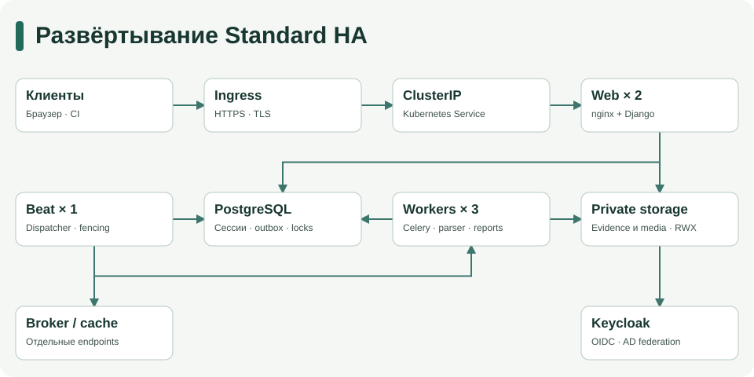
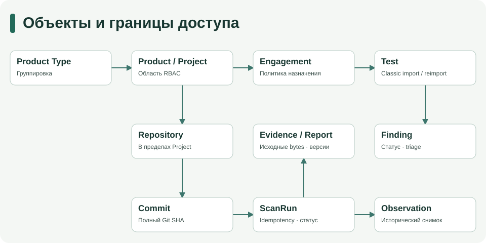
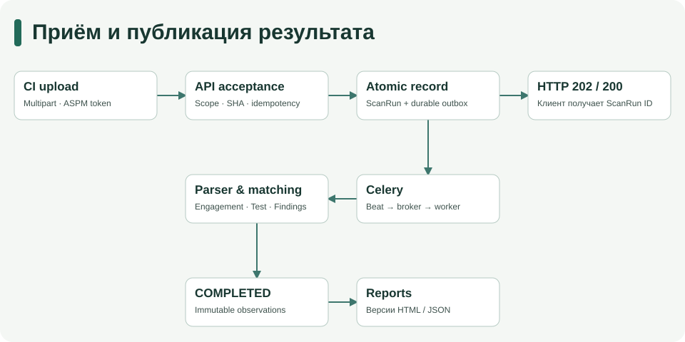
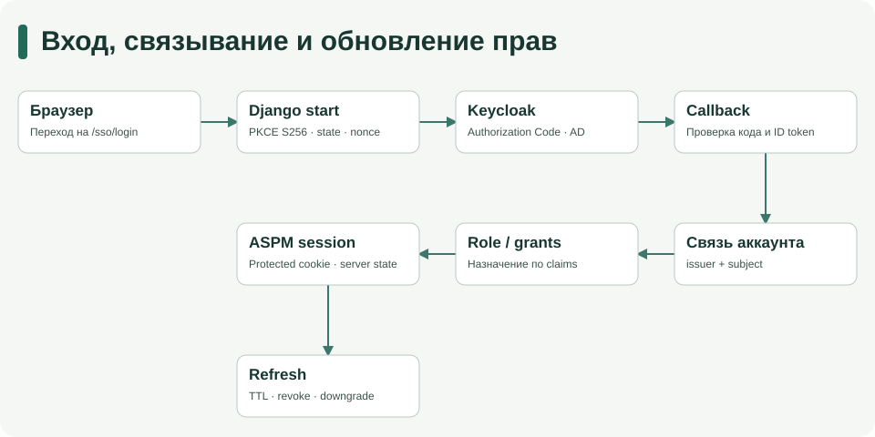

# 02 | Архитектура

| Компонент | Функция и масштабирование |
|---|---|
| Ingress → ClusterIP → web | TLS на Ingress. nginx отдаёт статику и передаёт запрос Django/uWSGI внутри одного Pod. Web масштабируется репликами. Port 8081 для внутренних probes и метрик |
| Django | Classic CRUD, API v2/v3 и ASPM API, UI, OIDC и проверка разрешений |
| PostgreSQL primary | Доменные объекты, сессии, аудит, idempotency и outbox. Session advisory locks для обработки, миграций и Beat |
| Celery workers | Асинхронный импорт, наблюдения, отчёты и webhook. Число реплик и concurrency ограничено ресурсами БД и очереди |
| Celery Beat | Одна активная реплика с PostgreSQL lock. После восстановления dispatcher подбирает накопившийся outbox |
| Broker / cache | Внешние Redis/Valkey. Независимые URI и лимиты. Cache и транспорт задач наблюдаются отдельно |
| Private storage | S3 с versioning хранит оригиналы, отчёты и Classic media. В filesystem-профиле эти данные лежат в `/app/aspm-private` и `/app/media` на общих PVC. Право скачивания в обоих профилях проверяет Django |
| Keycloak | Внешний OIDC IdP. Keycloak отвечает за AD federation и claims, ASPM связывает учётные записи и вычисляет доступ |
| Мониторинг | Prometheus читает приватные endpoints и отправляет samples через remote_write в VictoriaMetrics. Grafana использует query API VictoriaMetrics |

Product связывает два контура. Engagement и Test сохраняют Classic модель. ScanRun привязан к Product и Commit, получает Engagement по политике. Parser создаёт или сопоставляет Findings. Наблюдения, исходные файлы и версии отчётов хранятся как отдельные объекты. Резервная копия согласует состояние PostgreSQL и версии S3 объектов либо снимки обоих PVC.

ACCEPTED подтверждает регистрацию запроса и durable outbox. COMPLETED подтверждает публикацию. Отчёт использует выбранные завершённые наблюдения и сохраняет manifest. Для FAILED проверьте error_code.

Standard HA предполагает внешнюю отказоустойчивость PostgreSQL, broker/cache, CSI, ingress и IdP. На одном узле его отказ останавливает размещённые на нём реплики. Замена Beat временно задерживает периодические задачи.

Исходные контракты в архиве: `dojo/aspm_access`, `dojo/aspm_ingestion`, `dojo/webhooks`, `dojo/scm`, `dojo/operations`, `dojo/db_migrations`, `deploy/helm/aspm`.
