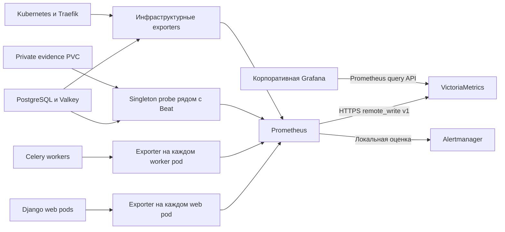

# Мониторинг ASPM 1.0.1

## Потоки и границы

OpenMetrics-совместимый exposition доступен с отдельного порта 9108 Pod без Ingress. NetworkPolicy разрешает сбор от согласованных Pod контроллера. Для scrape с bearer credential включите серверный TLS и укажите CA Secret. Обычные probes на 8081 и ingress на 8080 работают независимо. Включайте только один режим сбора для каждой установки ASPM.

## Образ Django для мониторинга

Новый Helm с включённым мониторингом требует Django image из ветки поставки. Пакет содержит source patch к ранее квалифицированному application SHA в monitoring/source. Его можно применить к исходникам исходной поставки командой git apply из корня source, затем собрать образ по основному руководству. Укажите в Helm repository и digest собранного образа. Результаты сканирования исходного приложения относятся к исходному образу. Новому corporate image требуются сборка и квалификация для платформы владельца.

## Existing Prometheus

Примените [overlay существующего Prometheus](helm-values/values-monitoring-existing.example.yaml) с фактическими selector labels, namespace и scrape interval. Для PodMonitor установите `monitoring.podMonitor.enabled=true` и выключите ServiceMonitor. Для обычного Prometheus используйте [scrape job](prometheus/scrape-config.example.yaml) и укажите сетевые selectors. Для Operator нужны установленные CRDs. Для дашбордов фильтры `cluster`, `environment`, `namespace`, `release` должны приходить с target или по remote_write из `externalLabels`. Для локальной оценки правил, использующих эти labels, предпочтительны target labels, включая self-scrape.

Администратор Prometheus добавляет отдельное назначение из [фрагмента Operator](prometheus/remote-write.operator.example.yaml) либо [фрагмента prometheus.yml](prometheus/remote-write.example.yaml), сохраняя текущие назначения. Пропустите только согласованные namespace, release и имена метрик. При общем Prometheus добавьте правила один раз и ограничьте селекторы согласованной областью ASPM.

## Dedicated Prometheus

Примените [dedicated overlay](helm-values/values-monitoring-dedicated.example.yaml), затем [remote write overlay](helm-values/values-victoriametrics-remote-write.example.yaml). Необходимы PVC с доступным StorageClass, разрешение на исходящий HTTPS и DNS, предоставленный endpoint и Secret. Collector запускается как один StatefulSet с локальной TSDB, запускает правила по флагу и автоматически обнаруживает каждый ASPM metrics pod из namespace релиза. Если отдельный сбор разрешён, опциональные exporters PostgreSQL и Valkey подключаются через `monitoring.exporters`. Для внешних exporters подойдут `monitoring.dedicated.extraScrapeConfigs` или корпоративные ServiceMonitor.

## VictoriaMetrics и Kubernetes Secrets

- Single-node обычно принимает `/api/v1/write`, vminsert обычно принимает `/insert/<tenant>/prometheus/api/v1/write`. Для vmauth используется полный URL владельца. Значения tenant и host указывает владелец.
- Bearer Secret содержит `token`. Basic Secret содержит `username` и `password`. В Operator `authorization` и `basicAuth` взаимоисключающие. В режиме с custom CA Secret содержит `ca.crt`; для mTLS добавьте `tls.crt` и `tls.key`. В Operator укажите `tlsConfig.cert.secret` и `tlsConfig.keySecret`. Проверка сертификата включена.
- Scrape Secret в namespace ASPM содержит `token`. Серверный TLS Secret содержит пару `tls.crt` и `tls.key`. CA Secret содержит `ca.crt`; сертификат должен покрывать согласованный `scrapeServerName` либо имена scrape endpoints.
- WAL отправляет сохранённые samples при восстановлении сети. Prometheus документирует окно приблизительно в два часа до компакции WAL в стандартном режиме. Фактический запас зависит от заполнения диска, аварий TSDB, рестартов, скорости ingest и backlog. Контролируйте lag и объём WAL, а для длинных сбоев учитывайте возможную потерю данных.
- Для HA Prometheus установите согласованные `externalLabels` и согласуйте с VictoriaMetrics политику dedup. Per-pod counters складывают после `rate()`; singleton gauges читают один раз на релиз. В Grafana уровень NO DATA обозначает отсутствие серии или выборки.
- Глобальные security gauges выключены отдельно в exporter и remote_write. Полный SQL и security labels с идентификаторами не входят в поставку.

## Проверка и диагностика

1. Проверьте Prometheus **Targets** и наличие двух web, трёх worker и одного singleton target для профиля HA, с учётом текущего rollout.
2. Выполните тестовую штатную операцию. Сравните её прирост в локальном Prometheus и через согласованный **query** endpoint VictoriaMetrics. У URL для remote write другая роль.
3. В Grafana импортируйте [готовые панели](provisioning/README.md). Для выбора источника применяется существующий datasource VictoriaMetrics. Доступность отдельных панелей зависит от [каталога](METRIC_CATALOG.md).
4. Используйте [инструкцию дежурного](runbooks/OPERATIONS.md), [список данных владельца](INFRASTRUCTURE_INPUT.md) и [фактическую проверку](VALIDATION.md).

[Prometheus remote write tuning](https://prometheus.io/docs/practices/remote_write/) · [Prometheus Operator API](https://prometheus-operator.dev/docs/api-reference/api/) · [VictoriaMetrics API](https://docs.victoriametrics.com/url-examples/index.html)
