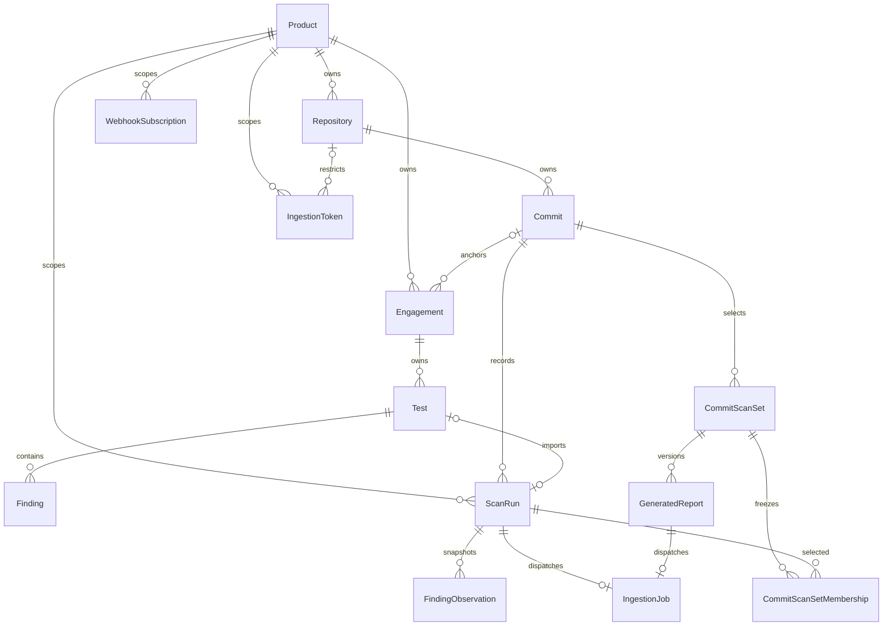

# ASPM architecture before integration

The working base is the local Enterprise Hardening tip `0011c221aba7d968ae0734dc1897a087fd9d55e6`. It contains the original Zero-Finalize candidate `25da29aaff229d3a815e223d8af8bdc4ecca7c5e`, application checkpoint `5133e155d102eb0f431560924ea129b2287319ff` and evidence checkpoint `9c54708e1bd12a9cb604bf0db67699cba3c71cb9`. The tip also contains chart packaging and webhook lab follow-ups. The current integration release line descends from the fork's `origin/dev`, `71ba3f0e1b8f338384b5c25c396aa2db687909ae`.

The same Product PK identifies each ASPM Project. Repositories use unique Product and canonical URL pairs. Commits use unique Repository and full Git SHA pairs. Evidence-aware PostgreSQL triggers fence changes to those identities. ScanRun stores an artifact location, SHA-256 and size in private storage. Observations contain value snapshots and carry no live Finding FK. See `dojo/scm/models.py`, `dojo/aspm_ingestion/models.py` and migrations 0311–0316.

## Import paths

- `POST /api/aspm/v1/scans/` authenticates a dedicated machine account, validates scope and the parser registry, stores the artifact, and atomically records the commit, delivery and outbox job. Product plus idempotency key is unique. The existing payload fingerprint includes scanner, commit, delivery metadata and content digest.
- In `dojo/aspm_ingestion/tasks.py`, the worker fences the job, verifies the stored file, creates one commit-bound CI/CD Engagement and one Test for each ScanRun, and calls the existing reimporter against that Test with `close_old_findings=False`. The one-to-one Test linkage survives retry. The existing RC5 per-Finding write protocol and import lock guard live triage.
- Completion publishes an observation generation and removes the outbox job. Live selection and versioned reports work without manual finalize. The optional legacy finalize route pins immutable membership. Strict API-only mode gates legacy scan-write routes while preserving the supported legacy configuration.
- `dojo/scm/imports.py` is the separate legacy adapter for SCM-aware standard import/reimport. It owns its own target validation and does not register API-only deliveries.

## Authorization and deployment

- Product and Product Type memberships plus OS staff/superuser paths drive existing object and query authorization. Ordinary authorized users can currently write through some legacy routes. Existing report/artifact authorization scopes the identifier through Product visibility. Platform webhook management uses `dojo.manage_outbound_webhooks` or superuser.
- The existing webhook module captures scan, report and finding events in the originating database transactions. It dispatches signed deliveries through its durable queue with retry and leases. See migrations 0317–0319 and `dojo/webhooks/`.
- The existing chart wires external PostgreSQL, Valkey, shared evidence storage, migration job, private metrics, web/worker/beat, health probes and a smoke hook. The brief's rc.1 chart is the documented baseline. The integration base already includes the rc.2 packaging fix.

## Integration gaps

- The current scan-to-Test database guard requires the Engagement's Commit to equal the ScanRun's Commit. Shared Engagements require an additive FK with explicit database checks. The legacy constraint remains necessary for existing scans.
- No Product or Repository policy or explicit Engagement delegation exists. Assignment must be stable across retries and each ScanRun must retain its own Test.
- The scanner factory has target parsers, but parser presence does not establish customer export compatibility or worker/report behavior.
- The base has no Keycloak login, issuer-plus-subject identities, claim-derived Product grants, or managed-session revocation. Native OS memberships alone cannot enforce USER read-only access or EXPERT role boundaries.
- The base includes themed Evidence and Webhook pages. It lacks role-specific entry points and engagement policy controls. The existing paginated evidence view and historical coverage states provide the integration point.
- Earlier regression and operational evidence applies to its recorded builds. New regression, protocol, operational and performance qualification is tracked separately.
