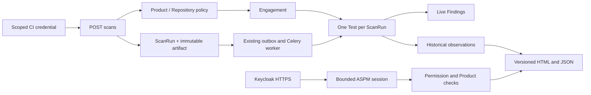

# Integrated architecture

The Product is the Project. Repository and Commit retain their existing identity constraints and primary keys. The ASPM API stores immutable evidence and enqueues the existing ingestion worker. The DefectDojo Test still owns live Findings. Report generation reads immutable observations and pins a set of runs and their generations.

Managed bindings use Repository PK, strategy and scope. A nullable ScanRun-to-Engagement FK pins the selection before job dispatch. The database still requires legacy Tests to follow their commit-bound Engagement and verifies that new Tests use the pinned Engagement. The existing PostgreSQL finding-write and webhook event protocols remain in the import path.

The SSO database stores issuer and subject identity links and Product grant mappings. Verified role and group claims are held in server-side session data until the configured freshness deadline. Native Product memberships and machine ingestion tokens are independent.
