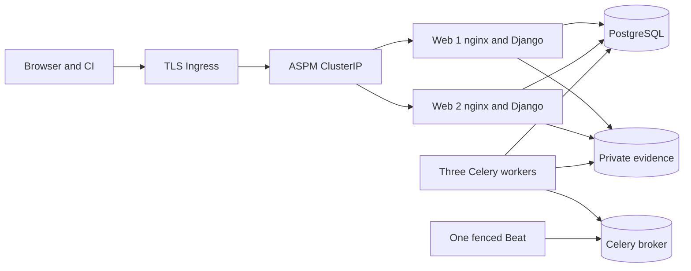

# Kubernetes HA

Ingress завершает TLS и направляет запросы в ASPM ClusterIP. ClusterIP выбирает один из двух web pod. Каждый содержит nginx и Django. Три worker взаимозаменяемо обслуживают существующую очередь. Beat запускается как один процесс с fencing через PostgreSQL. Контейнеры используют общий runtime Secret, общие PostgreSQL, cache и отдельный broker, evidence claim и media claim.

OrbStack предоставляет один узел. PostgreSQL, broker/cache, PVC и Ingress controller работают как лабораторные зависимости. Стандартный профиль принимает внешние зависимости и два RWX PVC через значения Helm. Node-level, external database failover и отказ ingress controller требуют дополнительной среды.

[Deployment, Services, PVC и PDB](raw/live-topology-final.txt) · [Манифест ASPM](raw/lab-rendered.yaml) · [Манифест gateway](raw/ingress-controller.yaml)

Внутренний Django metrics endpoint вернул HTTP 200. Со стороны ingress health и metrics вернули 404. Глубина broker и ingestion outbox проверена в лаборатории, usage PVC снят с web pod. Metrics API для Pod CPU/RAM не установлен, краткие замеры получены из Docker stats. [Наблюдаемость](raw/observability.txt)
