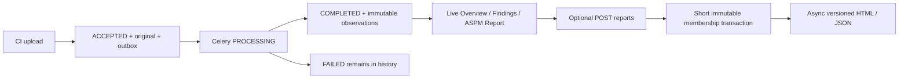

# Старый и новый жизненный цикл

Раньше: upload → process → обязательный finalize для reports и сравнения; Findings суммировал успешные reruns. Теперь: upload → видимый ScanRun → process → видимые актуальные historical results. Другие scanners не задерживают публикацию уже готовых результатов.

Finalize сохраняется как необязательная legacy-фиксация. Историческая корректность требует immutable original, observations generation и точного membership для фиксированного экспорта; отдельная публичная команда для видимости не нужна.
