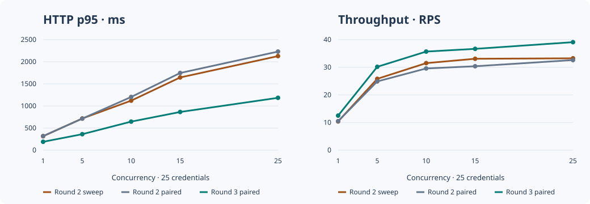

# DefectDojo 3.5.100 · Performance Round 3

## Стенд и нагрузка

Форк `kaiffan/aspm-improve`, worktree `codex/api-v2-performance-round3` от `38e0f04b60`. Round 2 на порту 48081 — подтверждённый образ 3.5.100. Он содержит пакетную загрузку vulnerability references, opt-in FAST OFFSET, Product summary/count и пакетную загрузку Jira в Tests. Round 3 наследует этот образ и заменяет только `dojo/finding/api/filters.py`. Оба варианта A/B доступны через локальный порт 48083. [Контрольные суммы образа](round3/after_image_hashes.txt).

Apple M5, 16 ГиБ RAM, OrbStack 10 CPU и 7,816 ГиБ RAM. Отдельные cgroup-лимиты CPU/RAM на PostgreSQL и uWSGI отсутствуют. PostgreSQL 18.6, `max_connections=100`, `shared_buffers=128MB`, `track_io_timing=off`. uWSGI использует 4 процесса × 4 потока и `CONN_MAX_AGE=0`. Начальный swap хоста был около 1,18 ГБ. Финальное сопоставимое A/B выполнено на AC с Low Power Mode=0. Промежуточные серии на батарее с Low Power Mode=1 сохранены отдельно. Источник питания первоначального sweep не зафиксирован, поэтому перенос цифр на серверное железо требует отдельного замера. [Питание](round3/power_config.txt). [Конфигурация](round3/config.txt).

[Воспроизведение](round3/REPRODUCE.md) · [Генератор](round3/mixed_load.py) распределяет запросы 40/20/15/10/10/5% по Findings list, фильтрованному Findings, Findings detail, Products count, Tests и Engagements. Во всех измеренных сериях участвовали 25 учётных данных независимо от concurrency. Использован один существующий администратор и созданы 24 тестовых пользователя с доступом к одному из трёх продуктов и непригодным для входа паролем. Секреты передаются через stdin. Два раунда по 300 измеренных запросов и 25 прогревочных на каждую точку. p50/p95/p99 ниже — медиана двух отдельных замеров квантиля. Клиент замеряет получение всего тела ответа. p99 при 300 запросах основан на нескольких хвостовых наблюдениях и имеет ориентировочный характер.

Сторож прерывает серию при массовых ошибках, OOM, остановке контейнера, превышении 7,2 ГиБ суммарной памяти контейнеров, свободной памяти хоста ниже 12% либо росте swap более 384 МиБ вместе с давлением памяти. Первый A/B прогон остановлен вручную после роста swap примерно на 420 МиБ и замедления контрольной сборки. Следующий прогон дошёл до c=25 и прервался во время сна macOS: 34 таймаута из 121 начатого запроса, также временно потерян мониторинг Docker. Эта серия исключена из итогового сравнения и сохранена. A/B повторено 11 ноября с процессным caffeinate против idle-sleep. Во время этой серии питание переключилось с батареи на AC; уровни 1–15 повторены на AC, успешные пары c=25 выполнены на AC. Промежуточные данные сохранены в `round3/ab_power_transition/`. [Прерванный прогон](round3/ab_sleep_interrupted/ab_c25_r1_before.json) · [События питания](round3/power_events.tsv). Финальное A/B выполнено с одним временно остановленным старым benchmark-контейнером Round 1 и одинаковой конфигурацией для обоих вариантов. Контейнер запущен обратно по завершении. [Первый прогон](round3/ab_pressure_trial/ab_metrics.jsonl).

## Исходная масштабируемость

| Concurrency | Запросов | p50 / p95 / p99, мс | RPS | Ошибки | Пик CPU uWSGI / PG, % | PG connections / active | Пик RSS worker, МиБ |
| ---: | ---: | ---: | ---: | ---: | ---: | ---: | ---: |
| 1 | 600 | 89 / 315 / 344 | 10.4 | 0% | 68 / 127 | 5 / 3 | 281 |
| 5 | 600 | 146 / 717 / 856 | 25.8 | 0% | 180 / 346 | 11 / 7 | 282 |
| 10 | 600 | 246 / 1121 / 1375 | 31.5 | 0% | 273 / 509 | 14 / 9 | 283 |
| 15 | 600 | 343 / 1645 / 1986 | 33.1 | 0% | 311 / 543 | 17 / 11 | 283 |
| 25 | 600 | 600 / 2128 / 2526 | 33.3 | 0% | 323 / 558 | 21 / 15 | 285 |

Первая отчётливая точка деградации — между 10 и 15. Дальше RPS держится примерно на уровне 33, p95 продолжает расти. На 25 одновременно предлагается больше запросов, чем 16 слотов uWSGI. При этом PostgreSQL достигал около 5,6 ядра, uWSGI — около 3,2 ядра, а общее число backend connections оставалось ≤21 из 100. CPU PostgreSQL и Python — ведущие ограничения под параллельным чтением. Ожидание слота uWSGI вероятно на c=25, а точный размер этой очереди в данной конфигурации не измерялся.

В baseline самое долгое замеченное активное SQL достигло 1625 мс. Ожидание I/O наблюдалось максимум у 9 backend одновременно. Свободная память хоста оставалась ≥43%, swap не рос, очередь Celery в read-only замерах оставалась пустой. Профиль обычного Findings list показал около 16–19 мс в `to_representation` на 100 результатов. Самым дорогим подтверждённым участком был точный count с Product/severity/active. [Ресурсы и SQL](round3/baseline_metrics.jsonl) · [Профиль](round3/baseline_profile.md).

## Исправление и BEFORE / AFTER

В `ApiFindingFilter` оба имени фильтра по одному Product теперь вычисляют Test ID одним SQL-подзапросом и применяют `finding.test_id = ANY(ARRAY(...))`. У PostgreSQL появляется возможность объединить фильтрацию по Test ID и severity до чтения heap. Исходный предикат авторизации работает отдельно. Запрос нескольких продуктов использует прежний путь. Изменение использует существующие индексы. Массив содержит ID тестов выбранного продукта, поэтому его стоимость зависит также от числа Tests в продукте; в текущем крупном продукте их восемь.

На крупнейшем продукте count вернул 63,688 записей в обоих вариантах. В сопоставимых планах `EXPLAIN ANALYZE` execution time 260 → 126 мс, сумма shared hit/read 162,777 → 66,462. Число SQL-запросов страницы 25 → 25. Профильные буферы показывают работу PostgreSQL, а не физические чтения SSD. [SQL до](round3/paired_profile_before.md) · [SQL после](round3/paired_profile_after.md) · [Альтернативные планы](round3/plan_trials.md).

| Concurrency | p50, мс | p95, мс | p99, мс | p95 фильтрованного Findings, мс | RPS | Ошибки после |
| ---: | ---: | ---: | ---: | ---: | ---: | ---: |
| 1 | 89 → 88 | 319 → 190 | 367 → 228 | 367 → 228 | 10.5 → 12.5 | 0% |
| 5 | 151 → 150 | 714 → 362 | 835 → 481 | 835 → 481 | 24.9 → 30.2 | 0% |
| 10 | 256 → 248 | 1204 → 646 | 1405 → 792 | 1405 → 746 | 29.6 → 35.7 | 0% |
| 15 | 370 → 400 | 1746 → 864 | 2152 → 1107 | 2152 → 1107 | 30.4 → 36.7 | 0% |
| 25 | 608 → 605 | 2231 → 1185 | 2605 → 1366 | 2605 → 1366 | 32.6 → 39.1 | 0% |

По две серии на вариант на уровнях 1, 5, 10, 15, 25. Очерёдность развёрнута во втором раунде. Состояние питания и кэша у отдельных фаз различалось. Эффект патча оценивается только по финальному парному A/B на AC. У нефильтрованных запросов и импорта другая форма SQL, поэтому общий эффект зависит от доли фильтрованных запросов. [Метрики A/B](round3/summary.json).

| Concurrency | CPU uWSGI, % | CPU PostgreSQL, % | Пик RSS worker, МиБ | PG connections | PG active queries | Shared blocks read |
| ---: | ---: | ---: | ---: | ---: | ---: | ---: |
| 1 | 165 → 64 | 301 → 117 | 290 → 228 | 7 → 5 | 3 → 3 | 4918304 → 2306044 |
| 5 | 282 → 213 | 436 → 366 | 289 → 227 | 14 → 9 | 9 → 5 | 4015436 → 2267707 |
| 10 | 296 → 310 | 545 → 440 | 289 → 230 | 17 → 16 | 9 → 10 | 3535952 → 1887845 |
| 15 | 317 → 344 | 544 → 484 | 294 → 234 | 19 → 17 | 12 → 5 | 3068818 → 1934788 |
| 25 | 296 → 336 | 524 → 559 | 291 → 229 | 24 → 24 | 18 → 18 | 3118592 → 1806078 |

CPU, RSS и число подключений — пики выборочного опроса, отдельные пики могут приходиться на разные моменты. Shared blocks read — медиана изменения счётчика базы за серию с прогревом. Сводная метрика включает фоновую активность. Свободная память в финальном A/B оставалась ≥50%, swap 1514–1514 МиБ. [Мониторинг](round3/ab_metrics.jsonl).

## Импорт и чтение

Две последовательности по три поддерживаемых POST на той же базе, в двух отдельных fixture-продуктах. ZAP XML содержал 40 alerts, по три URL с request/response на alert. Reimport заменил четыре правила, а импорт в соседний Test проверил дедупликацию. Использован `async_wait`. Дедупликация была включена только на время этого эксперимента и возвращена в исходное состояние. Во всех шести ответах HTTP 201 и `deduplication_complete=true`. Reimport создал 4, закрыл 4 и сохранил 36 findings в каждой последовательности. Повторный импорт создал 40 дубликатов в каждом fixture-продукте.

| Операция | HTTP без нагрузки, мс | HTTP на фоне c=10, мс | Celery post-processing, мс |
| --- | ---: | ---: | ---: |
| import | 1486 | 1670 | 49.6 → 87.0 |
| reimport | 768 | 948 | 35.5 → 88.3 |
| cross_test_duplicates | 830 | 1555 | 83.1 → 155.5 |

В одинаковом по времени окне старта запросов p95 чтения был 1326 → 1335 мс при 99 и 98 запросах. Из одной пары вывод о деградации чтения сделать нельзя. Полносерийный p95 1598 → 1317 мс включает запросы вне импорта. Во время эксперимента наблюдалась очередь до 4 сообщений, максимум 0 сэмплированных SQL lock waits. В сэмплах всего эксперимента контейнеры uWSGI, PostgreSQL и Celery достигли 1027, 209 и 182 МиБ соответственно. Журнал worker даёт время от приёма до окончания. Доставка от публикации до worker остаётся за пределами этой инструментализации. [Импорт без нагрузки](round3/import_idle.json) · [Импорт под нагрузкой](round3/import_loaded.json) · [Celery](round3/import_celery.json) · [Очередь и блокировки](round3/import_fast_metrics.jsonl).

## Проверка и откат

Изменены `dojo/finding/api/filters.py` и `unittests/test_api_finding_relation_filters.py`. Генератор смешанной нагрузки сохранён отдельно в `perf-report/round3/mixed_load.py`. На Round 2 новый тест воспроизвёл исходный SQL. На Round 3 **85 тестов прошли**, 6 штатно пропущены. Сравнены 35 HTTP-ответов, включая точный count, обе формы Product-фильтра, сортировку, отказ на чужой detail и глубокий FAST OFFSET. Ответы совпали побайтно. OpenAPI собран с `--fail-on-warn`. В БД остались 1,000,000 исходных findings и 168 новых fixture findings. [Проверки](round3/verification.txt) · [Сравнение ответов](round3/compatibility.json) · [Патч](round3/round3.patch).

Откат кода в worktree — `git apply -R --check /путь/к/round3.patch`, затем `git apply -R /путь/к/round3.patch`. Остановка проекта `dd35100-round3` отключает только новый A/B sidecar. Тестовые аккаунты и fixture-продукты сохранены в БД под отдельными именами.

## Ресурсы для 5–20 млн

Исходная база при 1 млн занимала 3,36 ГБ, включая 1,03 ГБ heap findings и 1,18 ГБ его индексов. Прямая экстраполяция ниже применима только к этому разреженному синтетическому набору. В запас диска включён коэффициент 1,7–2 для рабочего пространства, включая bloat, временные операции и локальный WAL. Хранение бэкапов нужно считать отдельно. RAM — стартовый диапазон для отдельного испытания, а не расчёт достаточности.

| Findings | Данные с индексами, ГБ | Рабочий диск, ГБ | RAM для тестового стенда, ГиБ |
| ---: | ---: | ---: | ---: |
| 5 млн | 16,8 | 29–34 | 16–32 |
| 10 млн | 33,6 | 57–67 | 32–48 |
| 20 млн | 67,3 | 114–135 | 32–64 |

На 1 млн PG и uWSGI вместе достигли 8.5 ядра в одном сэмпле. Для проверочного стенда 20 млн разумная отправная точка — 16 vCPU, NVMe и верхняя половина указанного диапазона RAM, с отдельной проверкой подключения и I/O. Требования к CPU при 20 млн нельзя вывести линейно из одного снимка. Точный count всё ещё проходит подходящие записи, стандартный глубокий OFFSET всё ещё сканирует строки до смещения, а Product full загружает все ID. Полноценные imports и связи увеличивают стоимость хранения по сравнению с синтетическим набором.

Отдельный тест на 5 млн можно провести в новом томе PostgreSQL из проверенной копии, добавить ограниченные партии до 5 млн и измерить тот же mix после ANALYZE. Прогон должен включать холодный и прогретый кэш, контроль размера индексов и повтор C1→25. Такой набор в Round 3 не создавался.
