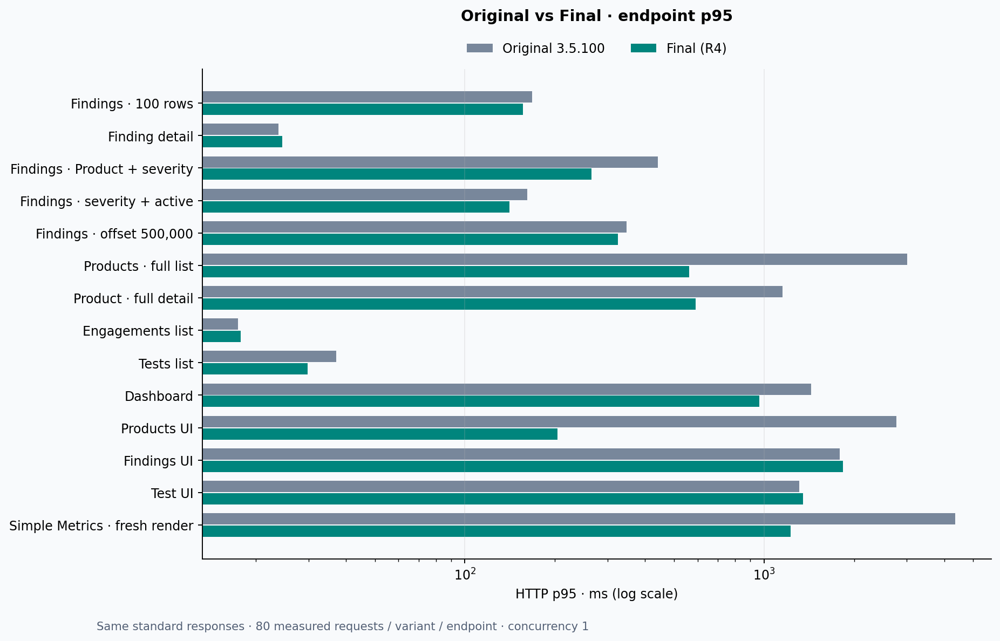
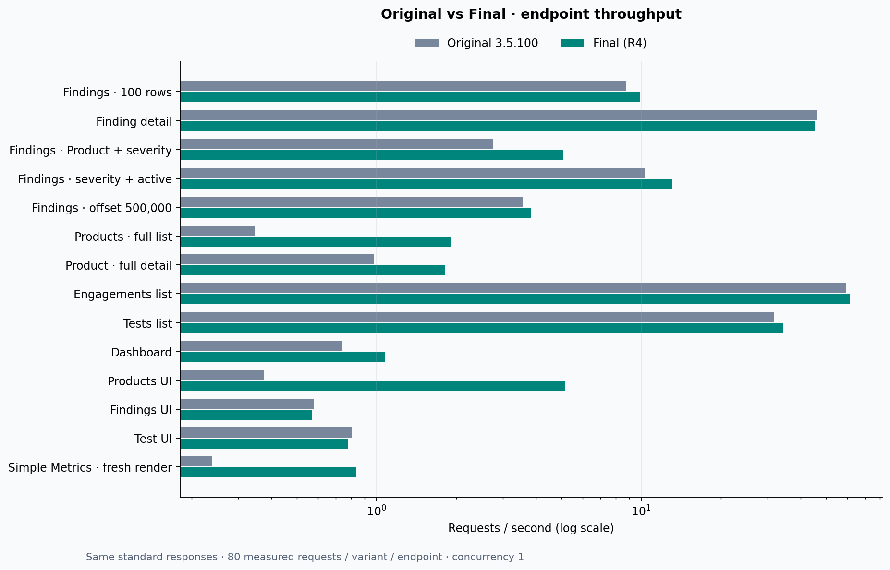
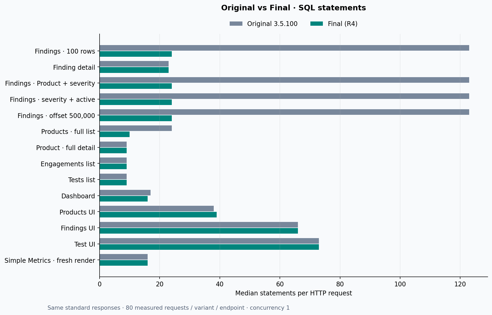
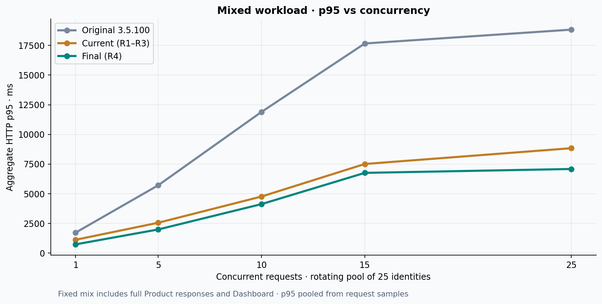
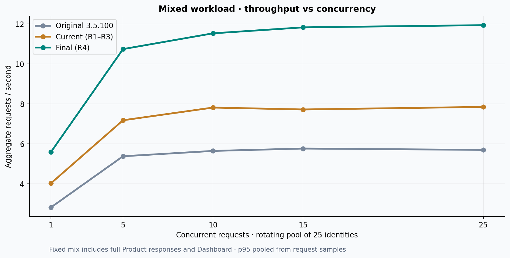
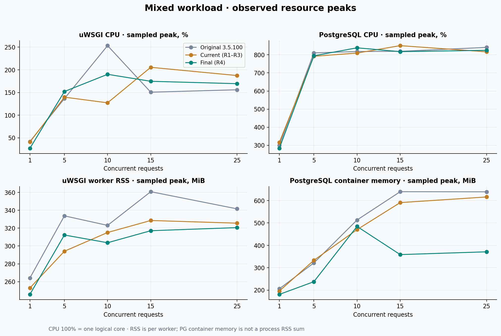

# DefectDojo 3.5.100 — Final Performance Report

## A. Executive Summary

На одном локальном стенде и неизменных **1,000,168 findings** выполнено **15,600 измеренных read-only запросов**. Дополнительно выполнены 3,600 запросов чтения и 54 import/reimport POST на трёх одинаковых копиях с корректной статистикой PostgreSQL. В выбранных итоговых сериях HTTP error rate — **0%**.

В mixed workload при 25 одновременно выполняемых запросах Original → Final: **p95 18.83 → 7.08 с**, **RPS 5.70 → 11.94**. Throughput вырос на **109.7%**, p95 снизился на **62.4%**. От CURRENT с Round 1–3 до FINAL: RPS **7.85 → 11.94**, p95 **8.84 → 7.08 с**.

Это стресс-тест полных стандартных API-ответов, Dashboard и Products UI. Он не сопоставим с прежними 39,1 RPS, полученными на другом mix с Product `findings=count`. Система ещё имеет многосекундные хвосты; готовность к 20 млн findings и production SLA здесь не доказана.

### Стенд и происхождение сборок

- ORIGINAL: официальный tag `3.5.100`, commit `334bef02d65a74909fe976b22724526474d5a0f6`; SHA сверён через upstream `git ls-remote`.
- CURRENT: `20771ddc0bdfb4b763708f70e1cd6c131c3f6b5e` — все фактические runtime-патчи Round 1–3 интегрированы в Git.
- FINAL: `70daa20757a9b5b99836343e50791a4de8c72fd0` — три новых исправления.
- Предыдущий `ea9f153a36` не содержал всех Finding runtime-файлов. Интеграция восстановила их и нормализовала семь несвязанных dev-файлов до релиза. [Манифест](integration_manifest.json).
- Код `/app/dojo` ORIGINAL полностью взят из чистого тега. Для CURRENT/FINAL проверены Git blob hashes и файлы в образах. Остальные runtime-зависимости, entrypoints и статические артефакты — из одного зафиксированного родительского образа. Непроверенная сборка на 8080 не использовалась как FINAL.
- Apple M5, 16 ГиБ RAM; Docker/OrbStack 10 CPU и 7.816 ГиБ RAM. PostgreSQL 18.6, Django 5.2.17, DRF 3.18.3, Python 3.14.8. uWSGI 4 процесса × 4 потока, `CONN_MAX_AGE=0`. PG `shared_buffers=128MB`, `work_mem=4MB`, `max_connections=100`. Отдельные cgroup CPU/RAM limits отсутствуют.
- Один активный benchmark web-container; старые Round 1–3 benchmark web-контейнеры временно остановлены. Основной 8080 и его данные сохранены. Изменений глобальной конфигурации PostgreSQL/Docker нет.

[Окружение и image IDs](environment.json) · [Runtime config](runtime_configuration.json) · [Проверка официального тега](official_tag_verification.txt) · [Fingerprint до/после чтения](fingerprint_after_readonly.json)

## B. Оптимизации по этапам

Исторические цифры ниже относятся к своим исходным испытаниям и не перемножаются в кумулятивное ускорение. Эти ранее выполненные исправления сохранены, их эффект заново проверяется в общей матрице C/D.

| Этап | Компонент | Проблема | Исправление | Ранее измеренный эффект |
|---|---|---|---|---|
| Round 1 | Finding API | N+1 vulnerability references | Prefetch в обеих ветках | 123 → 24 SQL на 100 findings |
| Round 1 | Pagination | Глубокий OFFSET | Opt-in two-stage ID pagination | OFFSET 500000, c=1: p95 640,74 → 291,68 мс |
| Product | Product API | Повторные COUNT и ID-запросы | Batch ordered IDs | c=1: SQL 22 → 10; p95 6170,7 → 1217,6 мс |
| Round 2 | Product detail/summary | Загрузка ID ради count | Detail batch; `findings=count/none` | Меньше загрузка ID и память; облегчённый ответ — отдельный контракт |
| Round 2 | Test Jira | N+1 связанных групп | Prefetch Jira relations | Fixture со 100 Tests: SQL 408 → 12 |
| Round 3 | Finding Product filter | Повторные heap scans в COUNT | Test IDs initplan + ANY array | Старый mix c=25: p95 2,23 → 1,19 с; RPS 32,6 → 39,1 |
| Round 4 | Products UI | Три коррелированных finding count на Product | Один групповой агрегат для страницы | Свежие CURRENT → FINAL ниже |
| Round 4 | Dashboard | Двойная дневная агрегация и два EXTRACT | Одна загрузка дневных групп; TruncMonth | Свежие CURRENT → FINAL ниже |
| Round 4 | Simple Metrics | Полные Finding-объекты ради чисел | SQL aggregation и узкий exact count | Свежие CURRENT → FINAL ниже |

Источники исторических результатов: [Round 1/Product](../RESULTS.md), [Round 2](../ROUND2_RESULTS.md), [Round 3](../ROUND3_RESULTS.md).

## C. ORIGINAL → FINAL: единая матрица

Одинаковые URL, права, БД и page size, concurrency 1. По 2 × 40 измеренных запросов, по 5 warmup на серию. SQL — медиана фактически измеренных statements на HTTP-запрос. p95 ниже в миллисекундах. Малые изменения контрольных маршрутов не считаются доказанным выигрышем.

| Endpoint / Scenario | Original p95 | Final p95 | Speedup (observed) | Original SQL | Final SQL |
|---|---:|---:|---:|---:|---:|
| Findings list, 100 | 167.9 | 156.3 | 1.07× | 123 | 24 |
| Finding detail | 23.8 | 24.6 | 0.97× | 23 | 23 |
| Findings, Product + High + active | 441.8 | 265.1 | 1.67× | 123 | 24 |
| Findings, High + active | 161.3 | 140.7 | 1.15× | 123 | 24 |
| Findings, OFFSET 500000 | 347.3 | 325.3 | 1.07× | 123 | 24 |
| Products full list | 3 002.5 | 561.2 | 5.35× | 24 | 10 |
| Product full detail | 1 152.9 | 591.0 | 1.95× | 9 | 9 |
| Engagements list | 17.5 | 17.8 | 0.98× | 9 | 9 |
| Engagement detail | 13.6 | 12.9 | 1.05× | 8 | 8 |
| Tests list | 37.1 | 29.8 | 1.24× | 9 | 9 |
| Test detail | 12.2 | 12.3 | 0.98× | 8 | 8 |
| Product types | 9.3 | 9.2 | 1.01× | 8 | 8 |
| Users | 11.3 | 11.2 | 1.01× | 7 | 7 |
| Endpoints | 21.3 | 21.5 | 0.99× | 8 | 8 |
| Endpoint status | 23.9 | 23.3 | 1.02× | 17 | 17 |
| Notes | 11.8 | 11.0 | 1.08× | 21 | 21 |
| Dashboard | 1 434.8 | 962.5 | 1.49× | 17 | 16 |
| Products UI | 2 766.2 | 203.6 | 13.58× | 38 | 39 |
| Findings UI | 1 788.2 | 1 836.7 | 0.97× | 66 | 66 |
| Engagements UI | 30.7 | 31.1 | 0.99× | 20 | 20 |
| Test UI | 1 311.5 | 1 349.4 | 0.97× | 73 | 73 |
| Simple Metrics, cache hit | 6.3 | 6.7 | 0.94× | 4 | 4 |
| Simple Metrics, fresh render | 4 361.6 | 1 226.4 | 3.56× | 16 | 16 |

Стандартный Products full имеет прежние данные и полный список ID; его размер не уменьшался. Полные RPS, p50/p99, размеры ответов, SQL milliseconds и RSS сохранены в [CSV](benchmark_results.csv) и [JSON](benchmark_results.json). p99 для endpoint n=80 не рассчитывается.

### Новые изменения: CURRENT → FINAL

| Сценарий | p95 | Ratio | SQL statements | Пик RSS worker в серии |
|---|---:|---:|---:|---:|
| Products UI | 2 682.9 → 203.6 мс | 13.17× | 38 → 39 | 246 → 249 МиБ |
| Dashboard | 1 364.6 → 962.5 мс | 1.42× | 17 → 16 | 250 → 249 МиБ |
| Simple Metrics, fresh render | 4 293.0 → 1 226.4 мс | 3.50× | 16 → 16 | 1 412 → 266 МиБ |

RSS — выборочные значения работающих процессов и включает память, оставшуюся от предыдущих сценариев. Это не изолированный прирост памяти одного запроса. SQL count Products UI вырос на один, при этом исчезли дорогие повторные вычисления. [Причины, SQL и EXPLAIN](NEW_BOTTLENECKS.md).

### Opt-in режимы

Эти ответы не сравниваются с полным ORIGINAL как одинаковая нагрузка. FAST остаётся экспериментальным; глобально не включён.

| Сценарий | Build | p95, мс | RPS | Response bytes | SQL |
|---|---|---:|---:|---:|---:|
| products_count | current | 60.4 | 17.66 | 10 820 | 10 |
| products_count | final | 66.0 | 16.55 | 10 820 | 10 |
| products_none | current | 15.2 | 72.59 | 10 484 | 9 |
| products_none | final | 15.5 | 72.20 | 10 484 | 9 |
| fast_offset | current | 168.0 | 10.08 | 287 160 | 25 |
| fast_offset | final | 170.4 | 9.99 | 287 160 | 25 |

## D. Общая производительность системы

Фиксированный mix: 30% Findings list, 15% Findings Product/High/active, 10% finding detail, 10% Products full, 10% Tests, 5% Engagements, 10% Dashboard, 5% Products UI, 5% Endpoints. Основной тест — saturation, без think time; использованы один superuser и 24 аккаунта с Product membership. 25 идентичностей распределены по воспроизводимому расписанию независимо от concurrency.

При c=1 — 2 × 100 запросов на вариант; при c=5/10/15/25 — 2 × 300. По 25 warmup. Первый раунд ORIGINAL → CURRENT → FINAL, второй FINAL → CURRENT → ORIGINAL. p95 и p99 рассчитаны по объединённым request samples, а не усреднением квантилей. RPS = все запросы / сумма длительностей измеренных серий. Для c=1 n=200, p99 не публикуется; при n=600 p99 остаётся оценкой небольшого числа хвостовых наблюдений.

| Concurrency | ORIGINAL p50/p95/p99, мс; RPS | CURRENT p50/p95/p99, мс; RPS | FINAL p50/p95/p99, мс; RPS |
|---:|---:|---:|---:|
| 1 | 125.3 / 1 721.5 / —; 2.82 | 96.7 / 1 117.0 / —; 4.02 | 95.5 / 731.4 / —; 5.59 |
| 5 | 249.0 / 5 711.4 / 8 246.7; 5.38 | 224.2 / 2 552.5 / 8 362.9; 7.18 | 238.0 / 1 987.3 / 2 357.7; 10.74 |
| 10 | 357.7 / 11 896.7 / 18 269.0; 5.64 | 321.7 / 4 763.4 / 17 930.8; 7.82 | 334.0 / 4 124.7 / 5 452.9; 11.53 |
| 15 | 478.0 / 17 663.1 / 26 823.7; 5.76 | 408.2 / 7 505.1 / 31 898.3; 7.72 | 398.8 / 6 756.7 / 8 783.1; 11.83 |
| 25 | 2 001.8 / 18 829.4 / 29 342.5; 5.70 | 1 466.5 / 8 836.1 / 34 204.1; 7.85 | 1 121.9 / 7 083.9 / 9 798.5; 11.94 |

### Критические сценарии внутри mix, c=25

| Case | ORIGINAL p95, мс | CURRENT p95, мс | FINAL p95, мс |
|---|---:|---:|---:|
| findings | 3 440.6 (n=180) | 2 802.4 (n=180) | 1 753.5 (n=180) |
| filtered_product | 6 289.2 (n=90) | 3 170.2 (n=90) | 2 801.4 (n=90) |
| finding_detail | 2 960.6 (n=60) | 2 106.7 (n=60) | 1 278.0 (n=60) |
| products | 25 393.3 (n=60) | 10 996.7 (n=60) | 10 497.2 (n=60) |
| dashboard | 7 811.0 (n=60) | 7 958.6 (n=60) | 6 735.4 (n=60) |
| web_products | 39 295.9 (n=30) | 35 438.6 (n=30) | 10 141.5 (n=30) |

Throughput выходит на плато около c=10–15, затем растёт задержка. uWSGI имеет 16 execution slots; при c=25 вероятно ожидание свободного слота. Его точная очередь отдельно не инструментировалась. В этом mix PostgreSQL CPU — ведущий предел: на c=25 PostgreSQL занимает около восьми логических ядер, uWSGI — примерно полтора-два. Дорогие exact counts и полные ID-массивы остаются ограничениями; Python-материализация особенно существенна для формирования Simple Metrics. Увеличение processes/threads в этом раунде не применялось.

### Независимые пользователи

Отдельная модель: 25 фиксированных аккаунтов, каждый выполняет свою заранее назначенную последовательность, think time 0,25 с. Это закрытая ограниченная серия, не моделирование неизвестного production arrival rate. Её числа не смешиваются с saturation.

| Build | Users | Requests | p95, мс | RPS | Errors |
|---|---:|---:|---:|---:|---:|
| original | 25 | 600 | 7 167.3 | 5.17 | 0% |
| current | 25 | 600 | 7 244.8 | 6.83 | 0% |
| final | 25 | 600 | 5 769.2 | 10.98 | 0% |

### Ресурсы mixed workload

Пики выборочного опроса; 100% CPU = одно логическое ядро. PG memory — память контейнера, не сумма RSS процессов. Deltas buffer reads/temp — сумма наблюдаемых изменений внутри серий, с несэмплированными краями; они включают фоновую активность и не означают физические чтения SSD. `track_io_timing=off`, точное время дискового I/O недоступно.

| c | Build | uWSGI CPU % | PG CPU % | Worker RSS MiB | PG container MiB | PG connections | Sampled shared reads | Sampled temp MiB |
|---:|---|---:|---:|---:|---:|---:|---:|---:|
| 1 | original | 42 | 300 | 264 | 206 | 5 | 26 014 941 | 1 167.7 |
| 1 | current | 41 | 315 | 253 | 196 | 5 | 16 886 959 | 1 194.5 |
| 1 | final | 27 | 283 | 246 | 181 | 5 | 9 801 118 | 899.3 |
| 5 | original | 136 | 811 | 334 | 321 | 11 | 81 777 759 | 2 582.4 |
| 5 | current | 140 | 792 | 294 | 333 | 13 | 56 587 782 | 2 499.5 |
| 5 | final | 152 | 795 | 312 | 238 | 13 | 37 765 384 | 2 283.6 |
| 10 | original | 253 | 818 | 323 | 513 | 18 | 75 949 325 | 2 598.6 |
| 10 | current | 127 | 810 | 315 | 470 | 19 | 51 531 246 | 2 724.2 |
| 10 | final | 190 | 839 | 304 | 484 | 19 | 33 279 006 | 2 132.5 |
| 15 | original | 151 | 819 | 361 | 640 | 24 | 71 237 529 | 2 447.4 |
| 15 | current | 206 | 851 | 329 | 591 | 24 | 58 491 957 | 2 901.7 |
| 15 | final | 175 | 818 | 317 | 359 | 24 | 34 463 715 | 2 239.0 |
| 25 | original | 156 | 841 | 342 | 639 | 25 | 66 029 118 | 2 507.7 |
| 25 | current | 187 | 817 | 326 | 616 | 25 | 46 953 436 | 2 649.6 |
| 25 | final | 169 | 825 | 321 | 371 | 25 | 28 635 236 | 1 765.9 |

Сторож контролировал OOM, состояние контейнеров, суммарную память Docker, host memory pressure, swap и AC/Low Power Mode. Наращивание нагрузки разрешалось только после успешных предыдущих уровней. Свободная память хоста в сэмплах оставалась не ниже 34%; swap 2115–2566 МиБ. Срабатываний guard не было. Подробные временные ряды находятся в `raw/*-metrics.jsonl` и `raw/*-rss.jsonl`.

## E. Графики

Автоматически построены из JSON/CSV скриптом [plot_results.py](plot_results.py), зависимости зафиксированы в [chart-requirements.txt](chart-requirements.txt).

## F. Корректность и background processing

**100 тестов: 92 passed, 8 skipped**. Новые regression guards воспроизвели четыре падения на CURRENT до исправлений; FINAL прошёл их. Все тесты повторены с файлами непосредственно из Git worktree, включая восстановленный модуль проверок прежнего runtime.

Сравнены 70 полных JSON payload-пары и 28 HTML context-пары: ошибок нет. Дополнительно проверены сортировка, count, страницы, доступ к чужим данным, CSV-фильтры, ordered vulnerability references с двумя связанными ID, FAST и fallback при нестандартной сортировке. HTML не объявляется побайтно идентичным: динамические значения дают различия хэшей; шаблоны не менялись. [Подробности](TEST_RESULTS.md), [пары ответов](compatibility.json).

### Import/reimport и дедупликация

Контролируемые ZAP scans: 40 alerts, по три URL с request/response evidence. В каждом варианте 3 последовательности без нагрузки и 3 под чтением c=10: import → reimport с заменой четырёх правил → duplicate-peer import. Продукт до теста имел 633794 findings; дедупликация выполнялась по Product. Использован поддерживаемый API и `async_wait`, один Celery worker process с hard limit 120 с. Каждый вариант начинал с идентичной копии 1000168 findings, той же статистикой планировщика и отдельными broker DB/media. Первые копии без column statistics исключены и сохранены в [архиве диагностики](background_unanalyzed/planner_statistics.json). Каноническая копия прошла ANALYZE перед созданием окончательных копий. Исходная БД не менялась.

Все 54 POST вернули 201 и завершённую дедупликацию. В каждой последовательности primary Test содержит 44 findings, из них 40 active; peer Test содержит 40 findings и 40 duplicates. Evidence и Location references присутствуют. API statistics совпали во всех трёх вариантах. [Прямые проверки БД](background_correctness.json).

| Build | Операция | Median idle, мс | Median under c=10, мс | Samples |
|---|---|---:|---:|---:|
| original | import | 787.2 | 922.3 | 3 + 3 |
| original | reimport | 741.7 | 744.8 | 3 + 3 |
| original | duplicates | 795.1 | 763.1 | 3 + 3 |
| current | import | 766.0 | 866.0 | 3 + 3 |
| current | reimport | 764.4 | 735.6 | 3 + 3 |
| current | duplicates | 787.0 | 880.3 | 3 + 3 |
| final | import | 796.4 | 877.3 | 3 + 3 |
| final | reimport | 670.9 | 748.2 | 3 + 3 |
| final | duplicates | 793.7 | 838.4 | 3 + 3 |

| Build | Read control p95 | Read + imports p95 | Control RPS | Loaded RPS | Requests |
|---|---:|---:|---:|---:|---:|
| original | 10 972.6 | 11 569.1 | 6.17 | 5.80 | 600 + 600 |
| current | 10 542.9 | 10 927.1 | 6.80 | 6.55 | 600 + 600 |
| final | 3 740.1 | 4 149.6 | 8.59 | 8.20 | 600 + 600 |

У каждого варианта одна control/loaded пара чтения; её нельзя считать надёжной оценкой причинного влияния импорта на production p95. Между сериями добавляются несколько сотен findings и прогревается кеш. Импортная производительность не заявляется отдельной успешной оптимизацией Round 4: импортный код не менялся.

| Build | Celery tasks SUCCESS | Task SQL executions | Task SQL total, мс | Worker HWM MiB | Publish→receive p95, мс |
|---|---:|---:|---:|---:|---:|
| original | 96 | 1 881 | 1 141.8 | 201.6 | 70.7 |
| current | 96 | 1 881 | 1 132.9 | 200.5 | 70.5 |
| final | 96 | 1 881 | 1 232.9 | 201.5 | 84.3 |

Время/SQL task измерены между Celery prerun/postrun, HWM накопительный для worker process. Publish/receive timestamps добавлены одинаковой benchmark-only инструментализацией; аргументы задач и SQL params не записывались. Подробности: [background summary](background_summary.json), `celery_*.json`, `raw/import-*.json`.

## G. Остаточные bottleneck

1. Exact COUNT Findings и ограниченных пользовательских scopes: работа растёт с подходящими строками. Отдельно остаются широкие DISTINCT-проекции Dashboard counters и заметные temp spills; это следующая задача для проверки узкого count по PK, а не повод удалять точный count.
2. Полный Products API читает и сериализует все активные ID: объём не ограничен числом Products на странице. Нужны осознанное использование существующих opt-in режимов и отдельная загрузка findings.
3. Standard deep OFFSET проходит строки до смещения. FAST ограничен подходящей сортировкой и остаётся opt-in.
4. PostgreSQL CPU/буферные чтения и Python CPU: RPS уже выходит на плато; простое увеличение клиентов увеличивает очередь и p95.
5. Findings UI и Test UI остаются дорогими; новые патчи их серверные запросы не оптимизируют.
6. Simple Metrics теперь ограничивает материализацию, но exact aggregates по большим Product Types всё ещё дороги, а число запросов зависит от числа типов.
7. В Notes API обнаружена загрузка history по строкам; на этом маленьком наборе абсолютная стоимость мала, поэтому патч не выбран.
8. Реальные импорты с историческими совпадениями, разными сканерами, большими evidence и одновременными интеграциями требуют отдельного объёмного теста.

## H. Масштабирование

Измерено только около 1 млн findings. Основная БД занимает 3.37 GB. Ниже — линейная экстраполяция разреженного синтетического storage footprint, а не измерение на 5–20 млн и не бюджет production. Disk reserve 1,7–2× условно учитывает рабочее место/WAL/bloat, резервные копии отдельно.

| Findings | Данные + индексы, GB | Рабочий диск, GB |
|---|---:|---:|
| 5 млн | 16.8 | 29–34 |
| 10 млн | 33.7 | 57–67 |
| 20 млн | 67.3 | 114–135 |

Многие синтетические строки не имеют production-плотности CWE, references, Locations, evidence, history и импортных связей. Реальная база может быть существенно больше. Полные ID-ответы растут линейно и способны занять сотни MB на ответ. Нагрузка 25 клиентов может умножить одновременно материализованные данные.

Планируемая application-нода 16 vCPU / 32 GB и внешняя HA PostgreSQL — следующий испытательный стенд, не подтверждённая ёмкость. Сначала повторить эту матрицу с реальной сетевой задержкой БД, затем согласованный отдельный тест на 5 млн в новом томе и реальные параллельные integrations. Контролировать steady-state и cold cache, I/O, heap fetches, рабочий набор индексов, очереди и память. Дополнительные миллионы в этом раунде не генерировались.

## I. Внедрение и откат

Новые production-файлы: `dojo/product/queries.py`, `dojo/product/ui/views.py`, `dojo/home/views.py`, `dojo/utils.py`, `dojo/metrics/views.py`. Новые/восстановленные тесты: `unittests/test_round4_performance.py`, `unittests/test_local_release_performance_checks.py`. Миграций, новых индексов, глобального кеша и новых production-сервисов нет. Benchmark-only middleware/broker/config не входят в application-патч.

- Для review Round 4: [round4.patch](round4.patch). Для релиза 3.5.100 со всеми этапами: [cumulative_performance.patch](cumulative_performance.patch).
- Нормализация версии в интеграционном коммите нужна для этого сравнения; при переносе на актуальный upstream dev не переносить несвязанные release-normalization изменения вслепую.
- Перед внедрением прогнать тесты на целевой ветке, проверить counts/sort/permissions и source hashes, повторить workload на целевой инфраструктуре.
- Сортировка Products UI по finding count сохраняет прежний подзапрос; максимальный выигрыш относится к стандартной сортировке.
- [Воспроизведение](REPRODUCE.md) · [Безопасный rollback](ROLLBACK.md). Основной 8080 этим исследованием не заменялся. После тестов восстановлены три ранее работавших benchmark-приложения. На 48084 оставлена FINAL read-only тестовая сборка на исходной БД без измерительного middleware; import worker/broker остановлены. [Итоговое состояние](final_checks.json).
