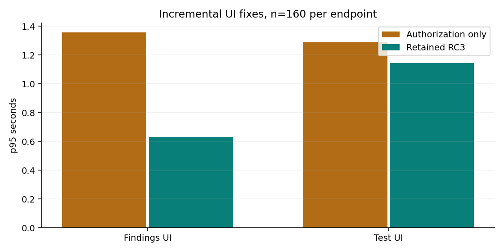

# Django and route delay map

## RC2 mixed c25 route contribution

| Route | Calls | p50 s | p90 s | p95 s | Mean s | Summed elapsed s | Elapsed share | SQL mean/max | SQL wall ms/request | Mean bytes | Share of slowest 5% |
| --- | --- | --- | --- | --- | --- | --- | --- | --- | --- | --- | --- |
| filtered_product | 135 | 1.259 | 5.855 | 6.171 | 2.462 | 332.307 | 30.3% | 24.9 / 25 | 1936.645 | 288120.2 | 57.8% |
| dashboard | 90 | 1.735 | N/A | N/A | 3.408 | 306.762 | 28.0% | 15.0 / 15 | 2997.442 | 49044.0 | 42.2% |
| findings | 270 | 0.635 | 0.918 | 1.010 | 0.654 | 176.578 | 16.1% | 25.0 / 25 | 88.328 | 292690.8 | 0.0% |
| products | 90 | 1.052 | N/A | N/A | 1.081 | 97.319 | 8.9% | 10.0 / 10 | 639.827 | 1640979.8 | 0.0% |
| finding_detail | 90 | 0.535 | N/A | N/A | 0.551 | 49.609 | 4.5% | 23.9 / 24 | 63.214 | 2584.4 | 0.0% |
| web_products | 45 | 0.964 | N/A | N/A | 1.037 | 46.664 | 4.3% | 25.9 / 39 | 639.523 | 92735.6 | 0.0% |
| tests | 90 | 0.482 | N/A | N/A | 0.492 | 44.289 | 4.0% | 9.0 / 9 | 31.418 | 5833.5 | 0.0% |
| engagements | 45 | 0.512 | N/A | N/A | 0.500 | 22.519 | 2.1% | 9.0 / 9 | 30.037 | 2693.3 | 0.0% |
| endpoints | 45 | 0.445 | N/A | N/A | 0.463 | 20.821 | 1.9% | 5.1 / 8 | 14.310 | 887.1 | 0.0% |

Small route samples do not support p95; the standalone table in RESULTS supplies
n=160 per endpoint. p99 requires n≥300. Summed request elapsed overlaps across
requests and is **not CPU share**. CPU/RSS/allocation snapshots are separate in
`raw/process-rc2.json` / `raw/process-rc3.json`, n=1 diagnostic per route/actor,
with tracemalloc overhead; no HTTP percentile is inferred from them.

## TOP-10 equal-count diagnostic routes

| Rank | Route | Calls/actors | Mean view+render ms | Total SQL wall ms | Mean SQL | Max SQL |
| --- | --- | --- | --- | --- | --- | --- |
| 1 | web_findings | 4 | 1477.394 | 4251.809 | 61.5 | 66 |
| 2 | web_test | 4 | 1147.670 | 2938.900 | 75.2 | 76 |
| 3 | reports | 4 | 755.944 | 1221.137 | 239.0 | 239 |
| 4 | dashboard | 4 | 448.780 | 1674.785 | 14.8 | 15 |
| 5 | filtered_product | 4 | 360.820 | 924.655 | 24.8 | 25 |
| 6 | offset | 4 | 264.112 | 765.498 | 14.2 | 25 |
| 7 | filtered_severity | 4 | 244.950 | 376.983 | 24.8 | 25 |
| 8 | products | 4 | 227.803 | 781.425 | 10.0 | 10 |
| 9 | simple_metrics_cold | 4 | 180.235 | 627.364 | 12.2 | 16 |
| 10 | simple_metrics | 4 | 179.706 | 626.170 | 12.2 | 16 |

This c1 diagnostic table has four named actors per route. It is a call-cost map,
not a substitute for mixed workload weights or a per-route p95 estimate.

## Separate CPU/allocation/RSS diagnostics

| Build | Route | Actors (n=1 each) | Mean traced process CPU ms | Mean peak Python allocations MiB | Max process RSS after MiB |
| --- | --- | --- | --- | --- | --- |
| rc2 | dashboard | 3 | 28.406 | 0.463 | 330.234 |
| rc2 | endpoints | 3 | 25.255 | 0.554 | 332.531 |
| rc2 | engagements | 3 | 20.683 | 0.428 | 328.438 |
| rc2 | filtered_product | 3 | 199.703 | 5.903 | 277.578 |
| rc2 | finding_detail | 3 | 41.632 | 0.818 | 277.578 |
| rc2 | findings | 3 | 215.177 | 6.124 | 278.562 |
| rc2 | products | 3 | 545.093 | 22.868 | 360.840 |
| rc2 | reports | 3 | 565.211 | 7.763 | 278.562 |
| rc2 | tests | 3 | 37.243 | 0.883 | 328.438 |
| rc2 | web_findings | 3 | 808.126 | 10.596 | 278.562 |
| rc2 | web_products | 3 | 79.326 | 0.942 | 331.500 |
| rc2 | web_test | 3 | 790.308 | 10.549 | 278.562 |
| rc3 | dashboard | 3 | 27.291 | 0.481 | 330.418 |
| rc3 | endpoints | 3 | 24.050 | 0.571 | 332.590 |
| rc3 | engagements | 3 | 20.986 | 0.406 | 330.027 |
| rc3 | filtered_product | 3 | 200.190 | 5.911 | 318.270 |
| rc3 | finding_detail | 3 | 43.898 | 0.838 | 318.270 |
| rc3 | findings | 3 | 212.375 | 6.130 | 318.270 |
| rc3 | products | 3 | 553.328 | 22.872 | 360.914 |
| rc3 | reports | 3 | 614.538 | 9.612 | 318.270 |
| rc3 | tests | 3 | 36.939 | 0.905 | 329.480 |
| rc3 | web_findings | 3 | 845.710 | 10.663 | 330.641 |
| rc3 | web_products | 3 | 72.860 | 0.941 | 331.543 |
| rc3 | web_test | 3 | 822.534 | 10.542 | 318.266 |

These traced measurements include diagnostic overhead and run in a separate
Django process. They measure application CPU, not database CPU or concurrent
worker utilization; rows cannot be summed into production load.

## Dashboard view, SQL and template components

| Build | Actor | View+render ms | SQL wall ms | SQL count | Max nested template render ms | Context processor self ms |
| --- | --- | --- | --- | --- | --- | --- |
| rc2 | admin | 399.723 | 372.075 | 14 | 14.288 | 0.039 |
| rc2 | restricted | 1164.740 | 1122.732 | 15 | 9.115 | 0.031 |
| rc2 | medium | 111.969 | 88.075 | 15 | 8.737 | 0.031 |
| rc2 | small | 118.688 | 91.903 | 15 | 8.896 | 0.031 |
| rc3 | admin | 396.444 | 373.099 | 14 | 10.989 | 0.037 |
| rc3 | restricted | 466.967 | 441.686 | 15 | 9.116 | 0.031 |
| rc3 | medium | 148.024 | 123.804 | 15 | 8.939 | 0.032 |
| rc3 | small | 144.930 | 119.980 | 15 | 9.036 | 0.032 |

Template render is the maximum inclusive nested render call, not a sum of
overlapping template calls. Context processor self time excludes child calls;
their complete inclusive/self timings are retained separately in each profile.
Every aggregate's SQL execution wall and Django caller stack are in sql-final
raw records; EXPLAIN execution times are server-only diagnostic replays.

Dashboard: view time includes the exact recent counts, one day/severity chart
aggregate and rendering. cProfile records template and context-processor calls
individually in `raw/profile-final-*.json`. The hot scoped chart/counter scans
previously revisited the Finding heap once per Test; authorization InitPlan now
resolves that scope once. Original chart boundaries, unknown severities, risk
acceptance uniqueness and timezone behavior remain guarded by R4/R5 tests. The
counter-batching experiment was rejected, so the exact counters remain separate.

Findings UI: title suggestions and CWE options are lazy QuerySets evaluated while
building filters/context; endpoint annotations previously grouped the full scope
before LIMIT. The selected PK page now precedes those annotations for local-field
sorts. Linked notes, Jira, vulnerability IDs, endpoints and evidence prefetches
remain. Related/random/custom orderings retain the original grouping/LIMIT path.
The new related-sort test proves one Finding with two acceptance dates does not
inflate a page of size one. A second test reproduces duplicate PKs before LIMIT
from a to-many filter: these joins retain the original annotation-before-page
path. The existing shared join detector is reused unchanged, with a compatible
import from dojo.filters. Projections, custom extra SQL, groups and combinations
also retain the original path.

Test UI: pagination/counting now precedes Finding prefetch annotations, matching
the list view's intended sequence for safe query shapes. Related ordering and
multiplying filters retain annotation/grouping before counting and pagination;
the expired-acceptance test verifies exact count=2 with overlapping acceptances.
Its product-tab exact open count and global
authorized autocomplete remain material costs. Notes/files/Jira/finding-group
template loops remain functionally unchanged and are checked by full suite and
real browser tests. Query count alone is not treated as the bottleneck.

Products full API still emits the complete ordered active ID lists and exact
counts. Products UI, detail, Tests, Engagements and Endpoints retain their response
and permission contracts. Reports builder is audited in the separate CPU/allocation
and view profiles and the actual browser run; report unit/integration cases are in
the full suite. Fast low-impact endpoints receive no speculative optimization.

