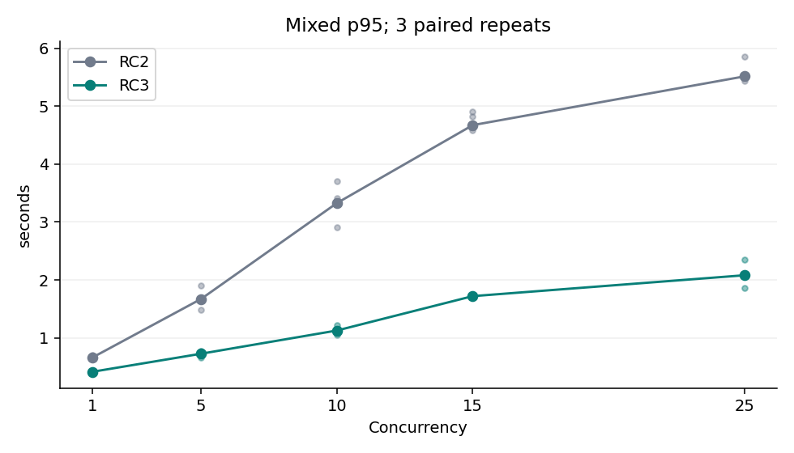
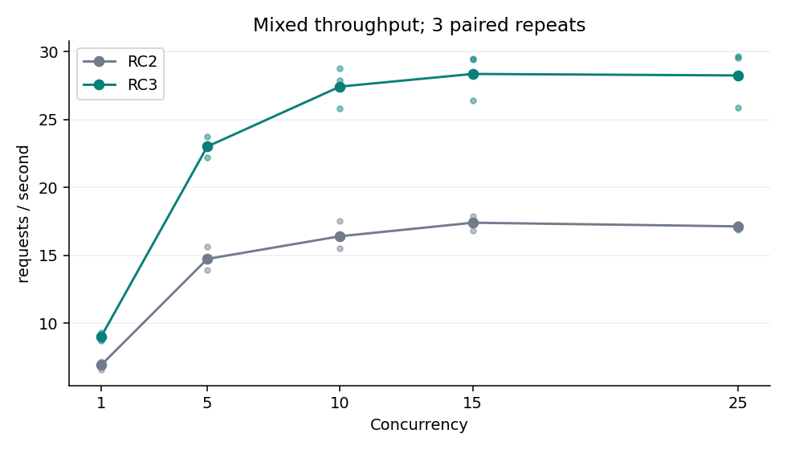
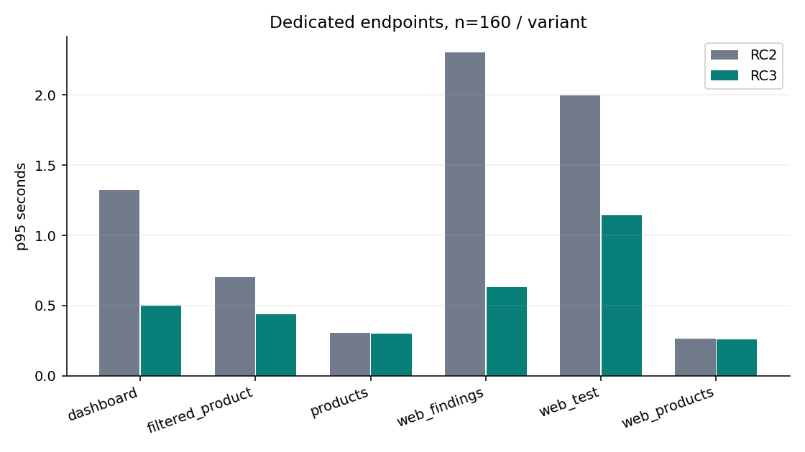
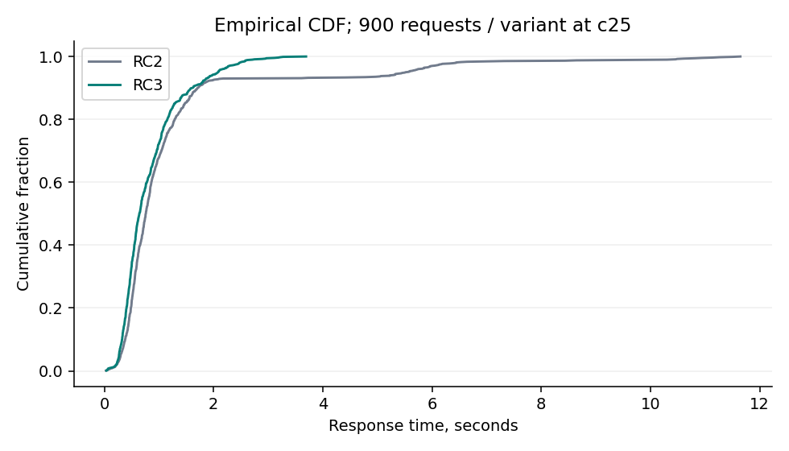
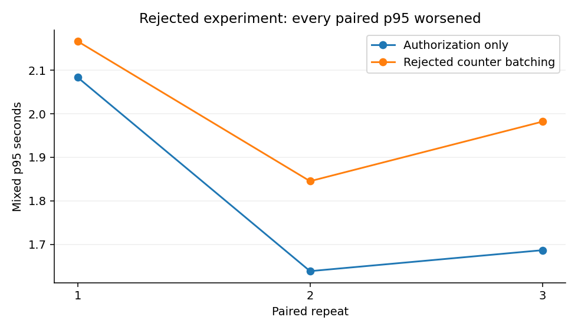

# Fresh paired results

| Показатель | RC2 | Optimized RC3 | Изменение |
| --- | --- | --- | --- |
| Mixed p50, s | 0.760 | 0.642 | -15.5% |
| Mixed p90, s | 1.710 | 1.609 | -5.9% |
| Mixed p95, s | 5.514 | 2.080 | -62.3% |
| Mixed p99, s | 10.302 | 2.708 | -73.7% |
| Throughput, RPS | 17.140 | 28.246 | +64.8% |
| PostgreSQL sampled CPU, % | 527.276 | 580.880 | +10.2% |
| App container peak, MiB | 969.200 | 989.800 | +2.1% |
| SQL execute wall/request, ms | 724.379 | 432.257 | -40.3% |
| HTTP errors | 0 | 0 | 0 |

| Variant | Repeat p95, s | Repeat RPS |
| --- | --- | --- |
| rc2 | 5.438, 5.502, 5.853 | 17.283, 17.264, 16.880 |
| rc3 | 2.093, 1.858, 2.351 | 29.542, 29.649, 25.885 |

| Concurrency | RC2 p95 s | RC3 p95 s | p95 change | RC2 RPS | RC3 RPS | RPS change |
| --- | --- | --- | --- | --- | --- | --- |
| 1 | 0.661 | 0.414 | -37.3% | 6.931 | 9.019 | +30.1% |
| 5 | 1.672 | 0.726 | -56.6% | 14.743 | 23.017 | +56.1% |
| 10 | 3.327 | 1.127 | -66.1% | 16.414 | 27.428 | +67.1% |
| 15 | 4.673 | 1.720 | -63.2% | 17.409 | 28.358 | +62.9% |
| 25 | 5.514 | 2.080 | -62.3% | 17.140 | 28.246 | +64.8% |

Each level has 300 measured +25 warmup requests per run, 3 repeats/build. Same
25 identities, seeds, case/actor schedule, full Product payload, database,
statistics, dependency images, uWSGI 4×4 and Docker limits. RPS=ΣN/Σelapsed;
percentiles pool observations. These are fixed-count saturation tests with a
drain period, not a production steady-state SLA. Three pairs establish a large
repeatable observed effect here; no claim of universal statistical significance.
Actor/case schedules and all API response byte sizes match exactly in every
pair. Existing HTML session-warning floating timestamps vary by at most 2 bytes
within each actor/route pair; this also occurs within a build. No padding or
payload reduction is applied. See `raw/cohort-verification.json` and the repeated
render check `raw/html-dynamic-size-check.json`; full semantic contexts also match.

## Standalone endpoints

| Case | n/build | RC2 p95 s | RC3 p95 s | Change | RC2 SQL wall ms | RC3 SQL wall ms | RC2 bytes | RC3 bytes |
| --- | --- | --- | --- | --- | --- | --- | --- | --- |
| dashboard | 160 | 1.322 | 0.497 | -62.4% | 483.258 | 258.727 | 49117.8 | 49117.8 |
| endpoints | 160 | 0.014 | 0.013 | -2.2% | 3.225 | 3.216 | 1451.6 | 1451.6 |
| engagements | 160 | 0.016 | 0.016 | +0.4% | 5.348 | 5.416 | 2549.7 | 2549.7 |
| filtered_product | 160 | 0.702 | 0.437 | -37.8% | 265.452 | 149.595 | 287845.8 | 287845.8 |
| finding_detail | 160 | 0.026 | 0.027 | +0.9% | 9.546 | 9.419 | 2584.7 | 2584.7 |
| findings | 160 | 0.143 | 0.150 | +4.6% | 19.099 | 17.273 | 292778.9 | 292778.9 |
| products | 160 | 0.304 | 0.300 | -1.6% | 134.606 | 134.817 | 1491076.3 | 1491076.3 |
| tests | 160 | 0.024 | 0.019 | -20.0% | 5.767 | 5.793 | 7383.2 | 7383.2 |
| web_findings | 160 | 2.302 | 0.633 | -72.5% | 979.703 | 275.338 | 1586448.4 | 1586448.4 |
| web_products | 160 | 0.262 | 0.258 | -1.6% | 120.307 | 118.517 | 88114.1 | 88114.2 |
| web_test | 160 | 1.996 | 1.145 | -42.6% | 698.148 | 422.762 | 1559939.3 | 1559939.4 |

Endpoint p95 uses n=160; endpoint p99 is not asserted below n=300. Small changes
on fast routes remain visible and are not treated as proven regressions or wins.
Full Products remains unchanged and its required ID payload remains a material
cost. Findings UI and Test UI are standalone only, never inserted into the mix.

## Incremental UI controls

| Route | Variant | Mean s | p50 s | p95 s | RPS | SQL wall ms/request |
| --- | --- | --- | --- | --- | --- | --- |
| web_findings | rc2 | 1.113 | 0.537 | 2.302 | 0.899 | 979.703 |
| web_findings | fix1 | 1.279 | 1.265 | 1.356 | 0.782 | 1147.094 |
| web_findings | rc3 | 0.404 | 0.302 | 0.633 | 2.478 | 275.338 |
| web_test | rc2 | 0.824 | 0.260 | 1.996 | 1.213 | 698.148 |
| web_test | fix1 | 1.139 | 1.106 | 1.289 | 0.878 | 1018.105 |
| web_test | rc3 | 0.548 | 0.261 | 1.145 | 1.823 | 422.762 |

`fix1` is authorization-only. Its small-scope global title-index walk can worsen
mean/throughput even when p95 improves; that intermediate regression is retained
here. The final UI fixes are evaluated against both RC2 and this intermediate
control. No lower intermediate p95 is presented as proof that every request won.

## Excluded or rejected cohorts

* `raw/rejected-dashboard/`: all 3 adverse incremental pairs and the deliberately
  stopped partial campaign; no samples selected out of a final run.
* `raw/pre-related-order-guard/`: the entire earlier successful 14,640-request
  candidate, retained after a separate edge-case test found related-sort page
  duplication. The final table uses the new guarded build, not those numbers.
* `raw/pre-multivalued-filter-guard/`: the complete subsequent 14,640-request
  cohort at 49066c037bc38a3795cad00ded7dd95f2fd16c96, superseded by a regression
  test proving a multiplying to-many filter must retain grouping before LIMIT.
* `raw/pre-test-ui-count-guard/`: successful full suite at 6c2e69590c68879e12610f8dcb7c8eb3f700a348
  and the initial authorization-only run. Campaign stopped when a real Test UI
  expired-acceptance test proved count=3 instead of 2; no RC3 comparison reused.
* `raw/interrupted-user-message/`: partial resource/RSS window when the tool
  session was stopped by follow-up input before endpoint JSON serialization.
* Tracing/cProfile and isolated pg_stat_statements HTTP observations are diagnostic
  cohorts, never pooled with the primary latency series.

CPU values are sampled and 100%=one core; app memory is Docker container memory,
not summed worker RSS. SQL execute wall includes waiting/network, not just PG
execution. Full raw observations, errors, resource windows and repeat results
are retained in `raw/`, CSV and JSON. Missing resource values stay N/A.
The c25 measured windows contain 12 RC2 and
6 RC3 resource samples; these short fixed-count runs give
coarse CPU estimates, not a steady-state utilization or capacity certification.

