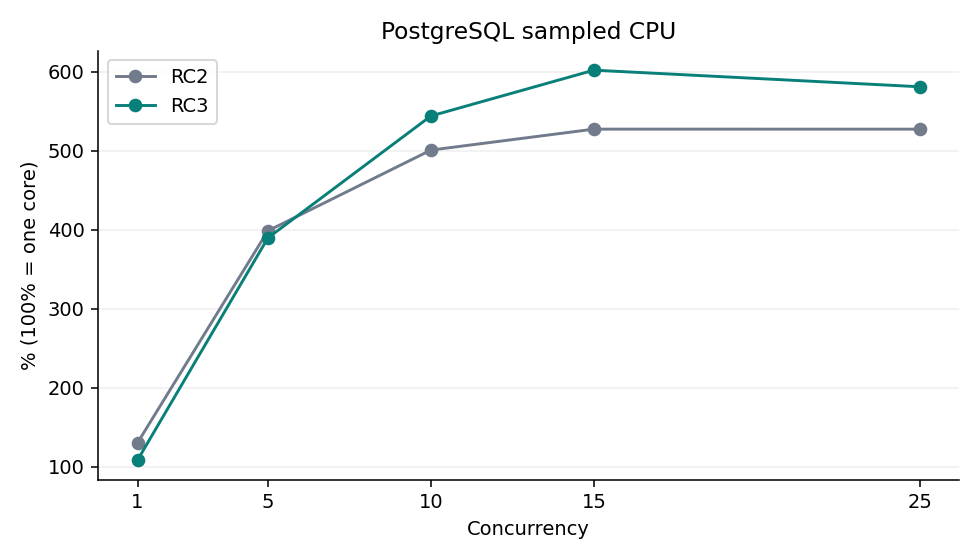
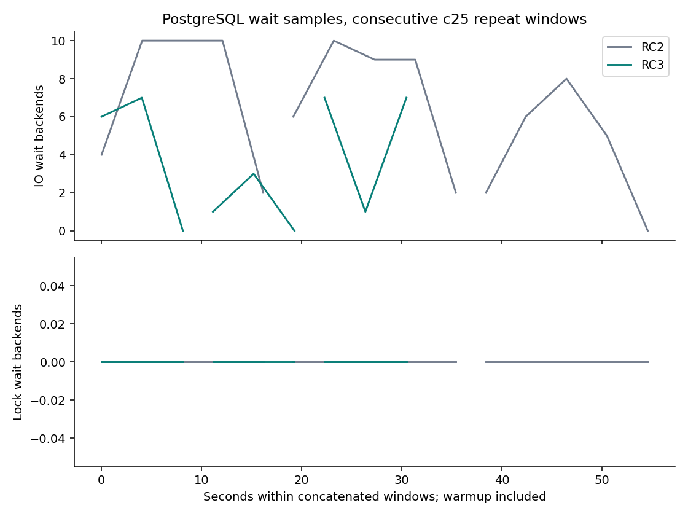
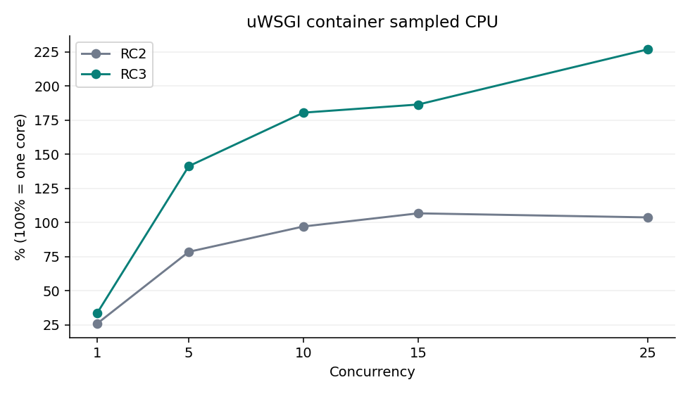
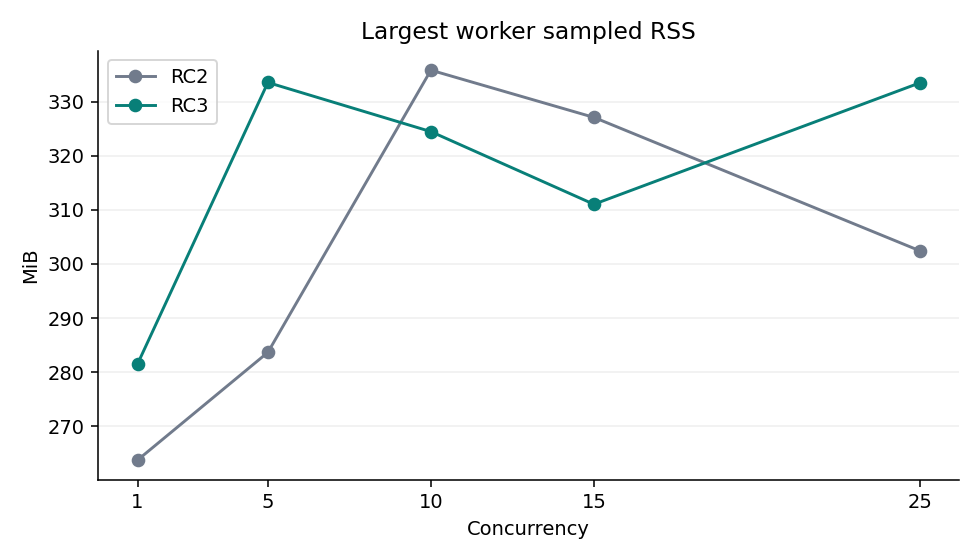

# Runtime audit

No runtime tuning was retained. uWSGI remains 4×4; CPU/RAM limits, connection age,
backlog, recycling and middleware are unchanged. Startup/cmdline evidence is in
`raw/runtime-final.json`; the exact middleware list and PG settings are in
`raw/environment.json`. Connection maxima, wait samples, swap/free memory, OOM,
container memory and each real worker RSS are retained per run. At c25, sampled
PG CPU was 527.276%→580.880% and app CPU
103.795%→226.818%. Throughput rises while
total busy CPU remains high; no reduction in total CPU is falsely asserted.

## Worker service time and residual

| Run | Matched | Mean worker ms | Mean queue+proxy+network residual ms | Max timestamp matching error ms |
| --- | --- | --- | --- | --- |
| campaign-rc2-r2-c25-mixed.json | 300 | 795.457 | 397.988 | 34.840 |
| campaign-rc3-r3-c25-mixed.json | 300 | 592.750 | 322.834 | 21.482 |
| campaign-rc3-r2-c25-mixed.json | 300 | 506.680 | 270.517 | 167.101 |
| campaign-rc2-r3-c25-mixed.json | 300 | 833.187 | 423.082 | 19.701 |
| campaign-rc3-r1-c25-mixed.json | 300 | 516.947 | 275.791 | 47.128 |

Access logs match identical actor, URL, response bytes/status and nearest completion
within 250 ms. The residual is an upper-bound style diagnostic including proxy,
transport and queueing; it is not an exact exclusive queue wait. Windows whose
container logs were already replaced are N/A, never zero. No worker count increase.

## Celery on the isolated write copy

Pool=prefork, concurrency=1, autoscale=1/1, prefetch multiplier=1, matching the
retained validation worker. Publish→start timing uses diagnostic headers; eligible
wait subtracts an intentional ETA/countdown. Execution is measured separately,
and RSS is each process's cumulative high-water mark, not per-task allocated RAM.

| Task | Calls | States | Mean execution ms | Max execution ms | Mean eligible queue wait ms | Peak process RSS MiB |
| --- | --- | --- | --- | --- | --- | --- |
| dojo.finding.helper.post_process_findings_batch | 3 | {'SUCCESS': 3} | 50.744 | 79.664 | 1.067 | 184.496 |
| dojo.notifications.tasks.async_create_notification | 8 | {'SUCCESS': 8} | 25.336 | 42.270 | 12.663 | 184.496 |
| dojo.tasks.update_watson_search_index_for_model | 10 | {'SUCCESS': 10} | 23.698 | 45.071 | 52.712 | 184.496 |

These are actual import/reimport/dedup/grade tasks on the validation copy, not a
claim about every scanner or million-row import. The primary mixed workload is
read-only with no worker/beat and a zero task queue. Celery/broker was not its
bottleneck, so neither configuration is changed. Diagnostic hooks and SQL middleware
are removed before leaving the candidate demo running.

