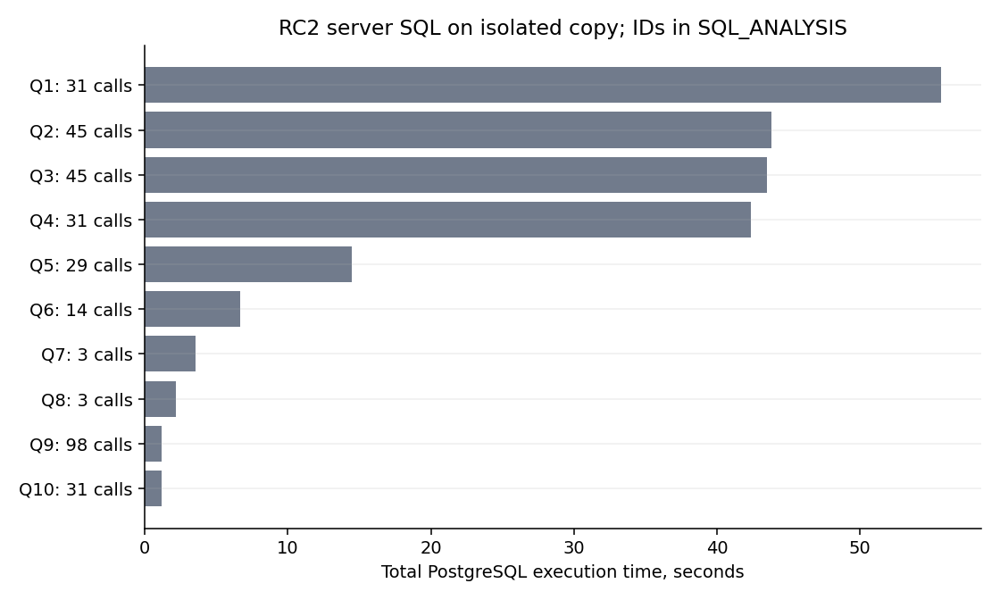
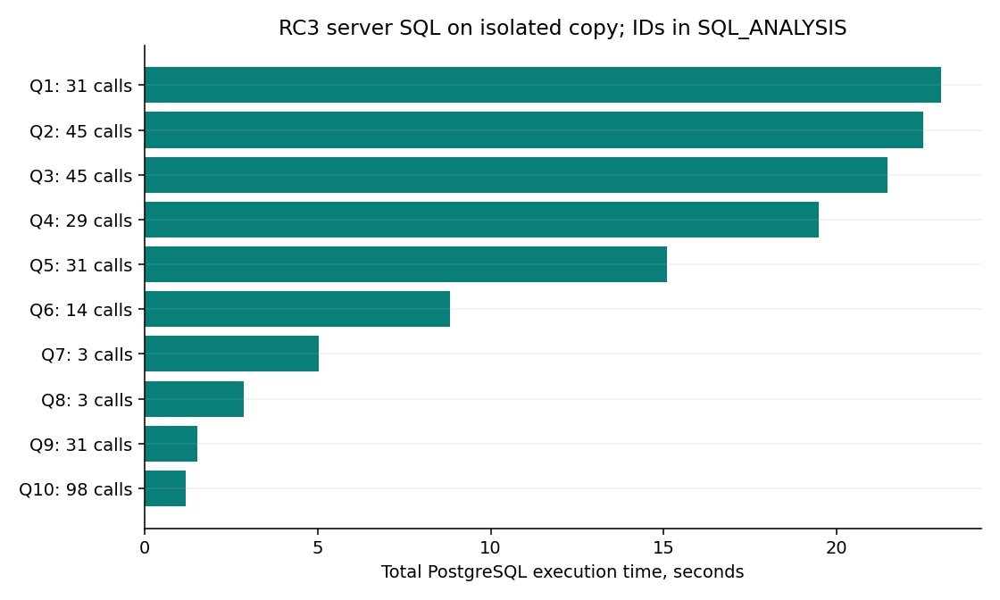

# PostgreSQL audit

Primary latency/SQL execute wall comes from the unchanged retained server.
Server cumulative execution totals below come from **pg_stat_statements on a
separate streamed copy**, with the same PostgreSQL image, row fingerprint,
configuration for both builds and one ANALYZE before either build. Only that
copy enables pg_stat_statements/IO timing. Source is never restarted or tuned.
Each server-stat window includes 300 measured +25 warmup HTTP requests; it is not
pooled into primary latency/RPS. Raw native rows include calls, execution, buffers,
temp IO, rows, WAL and available IO timing. No parameters/credentials are logged.

| Build | Concurrency | SELECT calls | Total exec ms | Shared read | Temp blocks written |
| --- | --- | --- | --- | --- | --- |
| rc2 | 1 | 6181 | 46877.549 | 28847975 | 11903 |
| rc3 | 1 | 6181 | 20647.428 | 9491279 | 11903 |
| rc2 | 10 | 6182 | 153315.485 | 17180658 | 11903 |
| rc3 | 10 | 6165 | 64449.867 | 8141186 | 11903 |
| rc2 | 25 | 6165 | 217835.221 | 15156308 | 11903 |
| rc3 | 25 | 6182 | 125541.530 | 8006311 | 11903 |


## RC2 server TOP-10, c25

| ID | Calls | Total exec ms | Mean exec ms | Rows | Shared hit/read | Temp read/write |
| --- | --- | --- | --- | --- | --- | --- |
| Q1 | 31 | 55685.735 | 1796.314 | 31 | 924202/5034431 | 0/0 |
| Q2 | 45 | 43788.293 | 973.073 | 45 | 1113326/1667202 | 0/0 |
| Q3 | 45 | 43481.232 | 966.250 | 4500 | 1178325/1602021 | 0/0 |
| Q4 | 31 | 42377.084 | 1367.003 | 155 | 2029169/3925824 | 0/0 |
| Q5 | 29 | 14447.571 | 498.192 | 29 | 260167/1278262 | 6272/6296 |
| Q6 | 14 | 6699.303 | 478.522 | 14 | 158670/597403 | 0/0 |
| Q7 | 3 | 3530.735 | 1176.912 | 42 | 38085/337592 | 5577/5607 |
| Q8 | 3 | 2166.277 | 722.092 | 3 | 32769/166015 | 0/0 |
| Q9 | 98 | 1197.598 | 12.220 | 98 | 10854/14846 | 0/0 |
| Q10 | 31 | 1165.427 | 37.594 | 31 | 8569/54037 | 0/0 |


### RC2 Q1

```sql
SELECT COUNT(*) FROM (SELECT DISTINCT "dojo_finding"."id" AS "pk" FROM "dojo_finding" INNER JOIN "dojo_test" ON ("dojo_finding"."test_id" = "dojo_test"."id") INNER JOIN "dojo_engagement" ON ("dojo_test"."engagement_id" = "dojo_engagement"."id") WHERE ("dojo_engagement"."product_id" IN (SELECT U0."id" AS "id" FROM "dojo_product" U0 LEFT OUTER JOIN "dojo_product_authorized_users" U1 ON (U0."id" = U1."product_id") INNER JOIN "dojo_product_type" U3 ON (U0."prod_type_id" = U3."id") LEFT OUTER JOIN "dojo_product_type_authorized_users" U4 ON (U3."id" = U4."product_type_id") WHERE (U1."dojo_user_id" = $1 OR U4."dojo_user_id" = $2)) AND NOT "dojo_finding"."duplicate" AND ("dojo_finding"."mitigated" AT TIME ZONE $3)::date BETWEEN $4::date AND $5::date)) subquery
```


### RC2 Q2

```sql
SELECT COUNT(*) AS "__count" FROM "dojo_finding" INNER JOIN "dojo_test" ON ("dojo_finding"."test_id" = "dojo_test"."id") INNER JOIN "dojo_engagement" ON ("dojo_test"."engagement_id" = "dojo_engagement"."id") WHERE ("dojo_engagement"."product_id" IN (SELECT U0."id" AS "id" FROM "dojo_product" U0 LEFT OUTER JOIN "dojo_product_authorized_users" U1 ON (U0."id" = U1."product_id") INNER JOIN "dojo_product_type" U3 ON (U0."prod_type_id" = U3."id") LEFT OUTER JOIN "dojo_product_type_authorized_users" U4 ON (U3."id" = U4."product_type_id") WHERE (U1."dojo_user_id" = $1 OR U4."dojo_user_id" = $2)) AND "dojo_finding"."severity" IN ($3) AND "dojo_finding"."active" AND "dojo_finding"."test_id" = ANY((ARRAY(SELECT U0."id" AS "pk" FROM "dojo_test" U0 INNER JOIN "dojo_engagement" U1 ON (U0."engagement_id" = U1."id") WHERE U1."product_id" = $4))))
```


### RC2 Q3

```sql
SELECT "dojo_finding"."id", "dojo_finding"."created", "dojo_finding"."updated", "dojo_finding"."title", "dojo_finding"."date", "dojo_finding"."sla_start_date", "dojo_finding"."sla_expiration_date", "dojo_finding"."cwe", "dojo_finding"."cve", "dojo_finding"."epss_score", "dojo_finding"."epss_percentile", "dojo_finding"."known_exploited", "dojo_finding"."ransomware_used", "dojo_finding"."kev_date", "dojo_finding"."cvssv3", "dojo_finding"."cvssv3_score", "dojo_finding"."cvssv4", "dojo_finding"."cvssv4_score", "dojo_finding"."url", "dojo_finding"."severity", "dojo_finding"."description", "dojo_finding"."mitigation", "dojo_finding"."fix_available", "dojo_finding"."fix_version", "dojo_finding"."impact", "dojo_finding"."steps_to_reproduce", "dojo_finding"."severity_justification", "dojo_finding"."refs", "dojo_finding"."test_id", "dojo_finding"."active", "dojo_finding"."verified", "dojo_finding"."false_p", "dojo_finding"."duplicate", "dojo_finding"."duplicate_finding_id", "dojo_finding"."out_of_scope", "dojo_finding"."risk_accepted", "dojo_finding"."under_review", "dojo_finding"."last_status_update", "dojo_finding"."review_requested_by_id", "dojo_finding"."under_defect_review", "dojo_finding"."defect_review_requested_by_id", "dojo_finding"."is_mitigated", "dojo_finding"."thread_id", "dojo_finding"."mitigated", "dojo_finding"."mitigated_by_id", "dojo_finding"."reporter_id", "dojo_finding"."numerical_severity", "dojo_finding"."last_reviewed", "dojo_finding"."last_reviewed_by_id", "dojo_finding"."param", "dojo_finding"."payload", "dojo_finding"."hash_code", "dojo_finding"."line", "dojo_finding"."file_path", "dojo_finding"."component_name", "dojo_finding"."component_version", "dojo_finding"."static_finding", "dojo_finding"."dynamic_finding", "dojo_finding"."scanner_confidence", "dojo_finding"."sonarqube_issue_id", "dojo_finding"."unique_id_from_tool", "dojo_finding"."vuln_id_from_tool", "dojo_finding"."sast_source_object", "dojo_finding"."sast_sink_object", "dojo_finding"."sast_source_line", "dojo_finding"."sast_source_file_path", "dojo_finding"."nb_occurences", "dojo_finding"."publish_date", "dojo_finding"."service", "dojo_finding"."planned_remediation_date", "dojo_finding"."planned_remediation_version", "dojo_finding"."effort_for_fixing", "dojo_finding"."archived_at", "dojo_finding"."archive_batch" FROM "dojo_finding" INNER JOIN "dojo_test" ON ("dojo_finding"."test_id" = "dojo_test"."id") INNER JOIN "dojo_engagement" ON ("dojo_test"."engagement_id" = "dojo_engagement"."id") WHERE ("dojo_engagement"."product_id" IN (SELECT U0."id" AS "id" FROM "dojo_product" U0 LEFT OUTER JOIN "dojo_product_authorized_users" U1 ON (U0."id" = U1."product_id") INNER JOIN "dojo_product_type" U3 ON (U0."prod_type_id" = U3."id") LEFT OUTER JOIN "dojo_product_type_authorized_users" U4 ON (U3."id" = U4."product_type_id") WHERE (U1."dojo_user_id" = $1 OR U4."dojo_user_id" = $2)) AND "dojo_finding"."severity" IN ($3) AND "dojo_finding"."active" AND "dojo_finding"."test_id" = ANY((ARRAY(SELECT U0."id" AS "pk" FROM "dojo_test" U0 INNER JOIN "dojo_engagement" U1 ON (U0."engagement_id" = U1."id") WHERE U1."product_id" = $4)))) ORDER BY "dojo_finding"."id" ASC LIMIT $5
```


### RC2 Q4

```sql
SELECT ("dojo_finding"."created" AT TIME ZONE $1)::date AS "created__date", "dojo_finding"."severity" AS "severity", COUNT("dojo_finding"."severity") AS "count", COUNT("dojo_finding"."id") AS "total" FROM "dojo_finding" INNER JOIN "dojo_test" ON ("dojo_finding"."test_id" = "dojo_test"."id") INNER JOIN "dojo_engagement" ON ("dojo_test"."engagement_id" = "dojo_engagement"."id") WHERE ("dojo_engagement"."product_id" IN (SELECT U0."id" AS "id" FROM "dojo_product" U0 LEFT OUTER JOIN "dojo_product_authorized_users" U1 ON (U0."id" = U1."product_id") INNER JOIN "dojo_product_type" U3 ON (U0."prod_type_id" = U3."id") LEFT OUTER JOIN "dojo_product_type_authorized_users" U4 ON (U3."id" = U4."product_type_id") WHERE (U1."dojo_user_id" = $2 OR U4."dojo_user_id" = $3)) AND NOT "dojo_finding"."duplicate") GROUP BY 2, 1
```


### RC2 Q5

```sql
SELECT $1 AS "_product_id", ARRAY_AGG("dojo_finding"."id" ORDER BY "dojo_finding"."id") AS "finding_ids" FROM "dojo_finding" WHERE ("dojo_finding"."active" AND "dojo_finding"."test_id" = ANY((ARRAY(SELECT U0."id" AS "pk" FROM "dojo_test" U0 INNER JOIN "dojo_engagement" U1 ON (U0."engagement_id" = U1."id") WHERE U1."product_id" = $2))))
```


### RC2 Q6

```sql
SELECT $1 AS "_product_id", COUNT("dojo_finding"."id") AS "active", COUNT("dojo_finding"."id") FILTER (WHERE "dojo_finding"."verified") AS "verified" FROM "dojo_finding" WHERE ("dojo_finding"."active" AND "dojo_finding"."test_id" = ANY((ARRAY(SELECT U0."id" AS "pk" FROM "dojo_test" U0 INNER JOIN "dojo_engagement" U1 ON (U0."engagement_id" = U1."id") WHERE U1."product_id" = $2))))
```


### RC2 Q7

```sql
SELECT "dojo_engagement"."product_id" AS "_product_id", ARRAY_AGG("dojo_finding"."id" ORDER BY "dojo_finding"."id") AS "finding_ids" FROM "dojo_finding" INNER JOIN "dojo_test" ON ("dojo_finding"."test_id" = "dojo_test"."id") INNER JOIN "dojo_engagement" ON ("dojo_test"."engagement_id" = "dojo_engagement"."id") WHERE ("dojo_finding"."active" AND "dojo_engagement"."product_id" IN ($1 /*, ... */)) GROUP BY 1
```


### RC2 Q8

```sql
SELECT COUNT(*) AS "__count" FROM "dojo_finding" WHERE ("dojo_finding"."severity" IN ($1) AND "dojo_finding"."active" AND "dojo_finding"."test_id" = ANY((ARRAY(SELECT U0."id" AS "pk" FROM "dojo_test" U0 INNER JOIN "dojo_engagement" U1 ON (U0."engagement_id" = U1."id") WHERE U1."product_id" = $2))))
```


### RC2 Q9

```sql
SELECT COUNT(*) AS "__count" FROM "dojo_finding" INNER JOIN "dojo_test" ON ("dojo_finding"."test_id" = "dojo_test"."id") INNER JOIN "dojo_engagement" ON ("dojo_test"."engagement_id" = "dojo_engagement"."id") WHERE "dojo_engagement"."product_id" IN (SELECT U0."id" AS "id" FROM "dojo_product" U0 LEFT OUTER JOIN "dojo_product_authorized_users" U1 ON (U0."id" = U1."product_id") INNER JOIN "dojo_product_type" U3 ON (U0."prod_type_id" = U3."id") LEFT OUTER JOIN "dojo_product_type_authorized_users" U4 ON (U3."id" = U4."product_type_id") WHERE (U1."dojo_user_id" = $1 OR U4."dojo_user_id" = $2))
```


### RC2 Q10

```sql
SELECT COUNT(*) FROM (SELECT DISTINCT "dojo_finding"."id" AS "pk" FROM "dojo_finding" INNER JOIN "dojo_test" ON ("dojo_finding"."test_id" = "dojo_test"."id") INNER JOIN "dojo_engagement" ON ("dojo_test"."engagement_id" = "dojo_engagement"."id") WHERE ("dojo_engagement"."product_id" IN (SELECT U0."id" AS "id" FROM "dojo_product" U0 LEFT OUTER JOIN "dojo_product_authorized_users" U1 ON (U0."id" = U1."product_id") INNER JOIN "dojo_product_type" U3 ON (U0."prod_type_id" = U3."id") LEFT OUTER JOIN "dojo_product_type_authorized_users" U4 ON (U3."id" = U4."product_type_id") WHERE (U1."dojo_user_id" = $1 OR U4."dojo_user_id" = $2)) AND NOT "dojo_finding"."duplicate" AND "dojo_finding"."date" BETWEEN $3::date AND $4::date)) subquery
```


## RC2 diagnostic call-site/plan index

| Shape ID | Routes | Calls / total wall ms | Representative server ms | Root buffers | Max loops | Django callers |
| --- | --- | --- | --- | --- | --- | --- |
| 808345551f29 | reports, web_findings, web_test | 9 / 2038.956 | 643.032 | Buffers: shared hit=6 read=482300, temp written=7751 | 36 | /app/dojo/finding/ui/views.py:316:get_initial_context, /app/dojo/finding/ui/views.py:380:get, /app/dojo/finding/ui/views.py:403:get, /app/dojo/reports/ui/views.py:128:get_available_widgets, /app/dojo/reports/ui/views.py:140:get_context, /app/dojo/reports/ui/views.py:94:get, /app/dojo/test/ui/views.py:165:get_initial_context, /app/dojo/test/ui/views.py:221:get, /app/dojo/utils.py:1617:get_words_for_field |
| 869e594fc830 | web_findings | 3 / 1483.470 | 967.961 | Buffers: shared hit=32239 read=128080 written=4 | 840362 | /app/dojo/finding/ui/views.py:397:get, /app/dojo/finding/ui/views.py:403:get |
| 8ac83e28e6be | web_findings | 1 / 1451.549 | 1484.884 | Buffers: shared hit=29207 read=128070 | 1 | /app/dojo/finding/ui/views.py:397:get, /app/dojo/finding/ui/views.py:403:get |
| d5e037877d50 | simple_metrics, simple_metrics_cold | 6 / 1071.387 | N/A | N/A | None | /app/dojo/metrics/views.py:224:simple_metrics |
| f31e5954643b | web_test | 4 / 873.084 | 405.651 | Buffers: shared hit=3 read=422838 | 100 | /app/dojo/test/ui/views.py:223:get, /app/dojo/utils.py:1412:open_findings_count, /app/dojo/utils.py:1475:findings |
| a358facc6c16 | web_test | 4 / 867.593 | 437.049 | Buffers: shared hit=29201 read=128069 | 1 | /app/dojo/test/ui/views.py:223:get |
| 1bcf069a654f | product_detail, products | 7 / 839.341 | 224.798 | Buffers: shared hit=13 read=125274, temp read=784 written=787 | 1 | /app/dojo/product/api/views.py:149:get_object, /app/dojo/product/api/views.py:155:paginate_queryset, /app/dojo/product/api/views.py:172:_load_findings_fields |
| db96b7ff31a7 | dashboard | 3 / 744.822 | 631.017 | Buffers: shared hit=5 read=482300 written=4 | 8 | /app/dojo/home/views.py:49:dashboard, /app/dojo/home/views.py:88:get_dashboard_chart_data |
| 5ce98caed224 | offset | 1 / 562.028 | N/A | N/A | None |  |
| e8e44f5b57f3 | dashboard | 3 / 538.412 | 479.805 | Buffers: shared hit=5 read=482300 | 8 | /app/dojo/home/views.py:43:dashboard |


This equal-count c1 diagnostic index is separate from native mixed pg_stat_statements totals. Server times replay bound parameters; root buffers are inclusive, never summed over nested nodes. Full SQL and caller details are retained in sql-callsite-index JSON.


## RC3 server TOP-10, c25

| ID | Calls | Total exec ms | Mean exec ms | Rows | Shared hit/read | Temp read/write |
| --- | --- | --- | --- | --- | --- | --- |
| Q1 | 31 | 23023.588 | 742.696 | 155 | 409319/1569217 | 0/0 |
| Q2 | 45 | 22491.353 | 499.808 | 45 | 272208/1016701 | 0/0 |
| Q3 | 45 | 21459.272 | 476.873 | 4500 | 395033/893201 | 0/0 |
| Q4 | 29 | 19474.985 | 671.551 | 29 | 314481/1224179 | 6272/6296 |
| Q5 | 31 | 15088.396 | 486.722 | 31 | 268220/1711404 | 0/0 |
| Q6 | 14 | 8820.193 | 630.014 | 14 | 139622/616757 | 0/0 |
| Q7 | 3 | 5017.887 | 1672.629 | 42 | 72414/303038 | 5577/5607 |
| Q8 | 3 | 2869.574 | 956.525 | 3 | 66366/131960 | 0/0 |
| Q9 | 31 | 1527.537 | 49.275 | 31 | 7680/54256 | 0/0 |
| Q10 | 98 | 1195.404 | 12.198 | 98 | 10577/13093 | 0/0 |


### RC3 Q1

```sql
SELECT ("dojo_finding"."created" AT TIME ZONE $1)::date AS "created__date", "dojo_finding"."severity" AS "severity", COUNT("dojo_finding"."severity") AS "count", COUNT("dojo_finding"."id") AS "total" FROM "dojo_finding" WHERE ("dojo_finding"."test_id" = ANY((ARRAY(SELECT V0."id" AS "pk" FROM "dojo_test" V0 INNER JOIN "dojo_engagement" V1 ON (V0."engagement_id" = V1."id") WHERE V1."product_id" IN (SELECT U0."id" AS "id" FROM "dojo_product" U0 LEFT OUTER JOIN "dojo_product_authorized_users" U1 ON (U0."id" = U1."product_id") INNER JOIN "dojo_product_type" U3 ON (U0."prod_type_id" = U3."id") LEFT OUTER JOIN "dojo_product_type_authorized_users" U4 ON (U3."id" = U4."product_type_id") WHERE (U1."dojo_user_id" = $2 OR U4."dojo_user_id" = $3))))) AND NOT "dojo_finding"."duplicate") GROUP BY 2, 1
```


### RC3 Q2

```sql
SELECT COUNT(*) AS "__count" FROM "dojo_finding" WHERE ("dojo_finding"."test_id" = ANY((ARRAY(SELECT V0."id" AS "pk" FROM "dojo_test" V0 INNER JOIN "dojo_engagement" V1 ON (V0."engagement_id" = V1."id") WHERE V1."product_id" IN (SELECT U0."id" AS "id" FROM "dojo_product" U0 LEFT OUTER JOIN "dojo_product_authorized_users" U1 ON (U0."id" = U1."product_id") INNER JOIN "dojo_product_type" U3 ON (U0."prod_type_id" = U3."id") LEFT OUTER JOIN "dojo_product_type_authorized_users" U4 ON (U3."id" = U4."product_type_id") WHERE (U1."dojo_user_id" = $1 OR U4."dojo_user_id" = $2))))) AND "dojo_finding"."severity" IN ($3) AND "dojo_finding"."active" AND "dojo_finding"."test_id" = ANY((ARRAY(SELECT U0."id" AS "pk" FROM "dojo_test" U0 INNER JOIN "dojo_engagement" U1 ON (U0."engagement_id" = U1."id") WHERE U1."product_id" = $4))))
```


### RC3 Q3

```sql
SELECT "dojo_finding"."id", "dojo_finding"."created", "dojo_finding"."updated", "dojo_finding"."title", "dojo_finding"."date", "dojo_finding"."sla_start_date", "dojo_finding"."sla_expiration_date", "dojo_finding"."cwe", "dojo_finding"."cve", "dojo_finding"."epss_score", "dojo_finding"."epss_percentile", "dojo_finding"."known_exploited", "dojo_finding"."ransomware_used", "dojo_finding"."kev_date", "dojo_finding"."cvssv3", "dojo_finding"."cvssv3_score", "dojo_finding"."cvssv4", "dojo_finding"."cvssv4_score", "dojo_finding"."url", "dojo_finding"."severity", "dojo_finding"."description", "dojo_finding"."mitigation", "dojo_finding"."fix_available", "dojo_finding"."fix_version", "dojo_finding"."impact", "dojo_finding"."steps_to_reproduce", "dojo_finding"."severity_justification", "dojo_finding"."refs", "dojo_finding"."test_id", "dojo_finding"."active", "dojo_finding"."verified", "dojo_finding"."false_p", "dojo_finding"."duplicate", "dojo_finding"."duplicate_finding_id", "dojo_finding"."out_of_scope", "dojo_finding"."risk_accepted", "dojo_finding"."under_review", "dojo_finding"."last_status_update", "dojo_finding"."review_requested_by_id", "dojo_finding"."under_defect_review", "dojo_finding"."defect_review_requested_by_id", "dojo_finding"."is_mitigated", "dojo_finding"."thread_id", "dojo_finding"."mitigated", "dojo_finding"."mitigated_by_id", "dojo_finding"."reporter_id", "dojo_finding"."numerical_severity", "dojo_finding"."last_reviewed", "dojo_finding"."last_reviewed_by_id", "dojo_finding"."param", "dojo_finding"."payload", "dojo_finding"."hash_code", "dojo_finding"."line", "dojo_finding"."file_path", "dojo_finding"."component_name", "dojo_finding"."component_version", "dojo_finding"."static_finding", "dojo_finding"."dynamic_finding", "dojo_finding"."scanner_confidence", "dojo_finding"."sonarqube_issue_id", "dojo_finding"."unique_id_from_tool", "dojo_finding"."vuln_id_from_tool", "dojo_finding"."sast_source_object", "dojo_finding"."sast_sink_object", "dojo_finding"."sast_source_line", "dojo_finding"."sast_source_file_path", "dojo_finding"."nb_occurences", "dojo_finding"."publish_date", "dojo_finding"."service", "dojo_finding"."planned_remediation_date", "dojo_finding"."planned_remediation_version", "dojo_finding"."effort_for_fixing", "dojo_finding"."archived_at", "dojo_finding"."archive_batch" FROM "dojo_finding" WHERE ("dojo_finding"."test_id" = ANY((ARRAY(SELECT V0."id" AS "pk" FROM "dojo_test" V0 INNER JOIN "dojo_engagement" V1 ON (V0."engagement_id" = V1."id") WHERE V1."product_id" IN (SELECT U0."id" AS "id" FROM "dojo_product" U0 LEFT OUTER JOIN "dojo_product_authorized_users" U1 ON (U0."id" = U1."product_id") INNER JOIN "dojo_product_type" U3 ON (U0."prod_type_id" = U3."id") LEFT OUTER JOIN "dojo_product_type_authorized_users" U4 ON (U3."id" = U4."product_type_id") WHERE (U1."dojo_user_id" = $1 OR U4."dojo_user_id" = $2))))) AND "dojo_finding"."severity" IN ($3) AND "dojo_finding"."active" AND "dojo_finding"."test_id" = ANY((ARRAY(SELECT U0."id" AS "pk" FROM "dojo_test" U0 INNER JOIN "dojo_engagement" U1 ON (U0."engagement_id" = U1."id") WHERE U1."product_id" = $4)))) ORDER BY "dojo_finding"."id" ASC LIMIT $5
```


### RC3 Q4

```sql
SELECT $1 AS "_product_id", ARRAY_AGG("dojo_finding"."id" ORDER BY "dojo_finding"."id") AS "finding_ids" FROM "dojo_finding" WHERE ("dojo_finding"."active" AND "dojo_finding"."test_id" = ANY((ARRAY(SELECT U0."id" AS "pk" FROM "dojo_test" U0 INNER JOIN "dojo_engagement" U1 ON (U0."engagement_id" = U1."id") WHERE U1."product_id" = $2))))
```


### RC3 Q5

```sql
SELECT COUNT(*) FROM (SELECT DISTINCT "dojo_finding"."id" AS "pk" FROM "dojo_finding" WHERE ("dojo_finding"."test_id" = ANY((ARRAY(SELECT V0."id" AS "pk" FROM "dojo_test" V0 INNER JOIN "dojo_engagement" V1 ON (V0."engagement_id" = V1."id") WHERE V1."product_id" IN (SELECT U0."id" AS "id" FROM "dojo_product" U0 LEFT OUTER JOIN "dojo_product_authorized_users" U1 ON (U0."id" = U1."product_id") INNER JOIN "dojo_product_type" U3 ON (U0."prod_type_id" = U3."id") LEFT OUTER JOIN "dojo_product_type_authorized_users" U4 ON (U3."id" = U4."product_type_id") WHERE (U1."dojo_user_id" = $1 OR U4."dojo_user_id" = $2))))) AND NOT "dojo_finding"."duplicate" AND ("dojo_finding"."mitigated" AT TIME ZONE $3)::date BETWEEN $4::date AND $5::date)) subquery
```


### RC3 Q6

```sql
SELECT $1 AS "_product_id", COUNT("dojo_finding"."id") AS "active", COUNT("dojo_finding"."id") FILTER (WHERE "dojo_finding"."verified") AS "verified" FROM "dojo_finding" WHERE ("dojo_finding"."active" AND "dojo_finding"."test_id" = ANY((ARRAY(SELECT U0."id" AS "pk" FROM "dojo_test" U0 INNER JOIN "dojo_engagement" U1 ON (U0."engagement_id" = U1."id") WHERE U1."product_id" = $2))))
```


### RC3 Q7

```sql
SELECT "dojo_engagement"."product_id" AS "_product_id", ARRAY_AGG("dojo_finding"."id" ORDER BY "dojo_finding"."id") AS "finding_ids" FROM "dojo_finding" INNER JOIN "dojo_test" ON ("dojo_finding"."test_id" = "dojo_test"."id") INNER JOIN "dojo_engagement" ON ("dojo_test"."engagement_id" = "dojo_engagement"."id") WHERE ("dojo_finding"."active" AND "dojo_engagement"."product_id" IN ($1 /*, ... */)) GROUP BY 1
```


### RC3 Q8

```sql
SELECT COUNT(*) AS "__count" FROM "dojo_finding" WHERE ("dojo_finding"."severity" IN ($1) AND "dojo_finding"."active" AND "dojo_finding"."test_id" = ANY((ARRAY(SELECT U0."id" AS "pk" FROM "dojo_test" U0 INNER JOIN "dojo_engagement" U1 ON (U0."engagement_id" = U1."id") WHERE U1."product_id" = $2))))
```


### RC3 Q9

```sql
SELECT COUNT(*) FROM (SELECT DISTINCT "dojo_finding"."id" AS "pk" FROM "dojo_finding" WHERE ("dojo_finding"."test_id" = ANY((ARRAY(SELECT V0."id" AS "pk" FROM "dojo_test" V0 INNER JOIN "dojo_engagement" V1 ON (V0."engagement_id" = V1."id") WHERE V1."product_id" IN (SELECT U0."id" AS "id" FROM "dojo_product" U0 LEFT OUTER JOIN "dojo_product_authorized_users" U1 ON (U0."id" = U1."product_id") INNER JOIN "dojo_product_type" U3 ON (U0."prod_type_id" = U3."id") LEFT OUTER JOIN "dojo_product_type_authorized_users" U4 ON (U3."id" = U4."product_type_id") WHERE (U1."dojo_user_id" = $1 OR U4."dojo_user_id" = $2))))) AND NOT "dojo_finding"."duplicate" AND "dojo_finding"."date" BETWEEN $3::date AND $4::date)) subquery
```


### RC3 Q10

```sql
SELECT COUNT(*) AS "__count" FROM "dojo_finding" WHERE "dojo_finding"."test_id" = ANY((ARRAY(SELECT V0."id" AS "pk" FROM "dojo_test" V0 INNER JOIN "dojo_engagement" V1 ON (V0."engagement_id" = V1."id") WHERE V1."product_id" IN (SELECT U0."id" AS "id" FROM "dojo_product" U0 LEFT OUTER JOIN "dojo_product_authorized_users" U1 ON (U0."id" = U1."product_id") INNER JOIN "dojo_product_type" U3 ON (U0."prod_type_id" = U3."id") LEFT OUTER JOIN "dojo_product_type_authorized_users" U4 ON (U3."id" = U4."product_type_id") WHERE (U1."dojo_user_id" = $1 OR U4."dojo_user_id" = $2)))))
```


## RC3 diagnostic call-site/plan index

| Shape ID | Routes | Calls / total wall ms | Representative server ms | Root buffers | Max loops | Django callers |
| --- | --- | --- | --- | --- | --- | --- |
| 9ae43fbe1c82 | reports, web_findings, web_test | 9 / 1139.268 | 269.361 | Buffers: shared hit=39 read=125642 written=4, temp written=7750 | 2 | /app/dojo/finding/ui/views.py:316:get_initial_context, /app/dojo/finding/ui/views.py:380:get, /app/dojo/finding/ui/views.py:403:get, /app/dojo/reports/ui/views.py:128:get_available_widgets, /app/dojo/reports/ui/views.py:140:get_context, /app/dojo/reports/ui/views.py:94:get, /app/dojo/test/ui/views.py:171:get_initial_context, /app/dojo/test/ui/views.py:227:get, /app/dojo/utils.py:1636:get_words_for_field |
| d5e037877d50 | simple_metrics, simple_metrics_cold | 6 / 1075.528 | N/A | N/A | None | /app/dojo/metrics/views.py:224:simple_metrics |
| f31e5954643b | web_test | 4 / 911.009 | 413.007 | Buffers: shared hit=14 read=422827 | 100 | /app/dojo/test/ui/views.py:229:get, /app/dojo/utils.py:1413:open_findings_count, /app/dojo/utils.py:1476:findings |
| 1bcf069a654f | product_detail, products | 7 / 843.011 | 233.307 | Buffers: shared hit=13 read=125274, temp read=784 written=787 | 1 | /app/dojo/product/api/views.py:149:get_object, /app/dojo/product/api/views.py:155:paginate_queryset, /app/dojo/product/api/views.py:172:_load_findings_fields |
| d40e23d6d60e | products | 1 / 457.062 | 464.047 | Buffers: shared hit=15876 read=109359, temp read=1859 written=1869 | 1 | /app/dojo/product/api/views.py:155:paginate_queryset, /app/dojo/product/api/views.py:172:_load_findings_fields |
| 56534bd034bc | dashboard | 3 / 412.037 | 308.146 | Buffers: shared hit=5 read=125676 written=4 | 2 | /app/dojo/home/views.py:49:dashboard, /app/dojo/home/views.py:88:get_dashboard_chart_data |
| 36b6a69aa1aa | offset | 1 / 302.340 | N/A | N/A | None |  |
| 9239befca1a5 | dashboard | 1 / 283.767 | 298.256 | Buffers: shared hit=15841 read=109391 | 1 | /app/dojo/home/views.py:49:dashboard, /app/dojo/home/views.py:88:get_dashboard_chart_data |
| 93bdb24cf53e | web_products | 3 / 271.981 | 200.617 | Buffers: shared hit=13 read=125274 written=4 | 1 | /app/dojo/product/queries.py:101:get_active_finding_counts_by_product, /app/dojo/product/ui/views.py:186:product |
| c7ca5e0f152b | dashboard | 3 / 255.318 | 150.586 | Buffers: shared hit=58 read=125679 | 3 | /app/dojo/home/views.py:43:dashboard |


This equal-count c1 diagnostic index is separate from native mixed pg_stat_statements totals. Server times replay bound parameters; root buffers are inclusive, never summed over nested nodes. Full SQL and caller details are retained in sql-callsite-index JSON.


## Call sites and plans

All expensive SELECTs have caller stacks and individual execute wall observations
in `raw/sql-final-rc2.json` / `raw/sql-final-rc3.json`. Corresponding actual plans:
`raw/plan-final-rc2.json` / `raw/plan-final-rc3.json`, using
`EXPLAIN (ANALYZE, BUFFERS, VERBOSE, TIMING OFF)`. TIMING OFF avoids per-node
clock overhead but retains actual rows/loops, buffers and total Execution Time.
The initial profiles/plans and autocomplete alternative plans are retained too.

* Dashboard counts: `dojo/home/views.py:dashboard`; three exact recent counters
  and one day/severity aggregate per request. DISTINCT is retained for exact
  unique Findings where a risk-acceptance join can fan out. Removing all DISTINCT
  would change correctness. Authorization formerly exposed per-Test heap scans:
  the large scoped chart read ~482,300 shared buffers over eight scans. The InitPlan
  retains every permission gate and visits the Finding heap without that outer join.
* Filtered Findings: `ApiFindingFilter.filter_product` plus scoped ViewSet; exact
  count and ordered page per request. Previously 63,688 matching wide rows were
  sorted for 100 results and the heap was revisited for each Test. The selected
  product Test-array filter is retained, now intersecting an authorized Test array
  instead of an outer Finding→Test→Engagement permission join.
* UI: `prefetch_for_findings` endpoint annotations previously grouped 532,569 rows
  for a page of 25; the PK page is now an IN subquery before grouping, in one SQL
  snapshot. Related ordering, multiplying outer joins and unsupported query
  shapes deliberately retain the original path, with behavioral regression tests.
* Autocomplete: `get_words_for_field`; bounded DISTINCT title/component values,
  not a template N+1. The first array-only candidate walked a global title index,
  rejected ~574,613 unrelated rows for a small scope, and regressed standalone UI.
  The authorized projection barrier changed that measured plan from ~1.240 s to
  ~0.049 s. The same unordered DISTINCT/LIMIT semantics and bound parameters remain;
  no global permission-sensitive cache is introduced. A large-scope hash aggregate
  can still spill; it is not hidden or replaced with incomplete counts.
* Products: `ProductViewSet._load_findings_fields`; exact ordered ARRAY_AGG IDs
  once per authorized page. The output itself is large and remains unchanged.
* Test UI: product-tab open count, filters, notes/Jira/evidence prefetches and
  endpoint annotations. These are separately visible in caller stacks/plans.

Small-table sequential scans and broad sequential scans with lower total cost
are not errors by themselves. No planner hint, disabled plan node, global work_mem
increase, new index or statistics manipulation is used to manufacture a win.
Shared buffer reads are not necessarily physical storage reads. Locks/waits are
sampled separately; they are not summed into CPU utilization. Residual expensive
work includes exact counts, full Product ID materialization, and broad aggregates.



