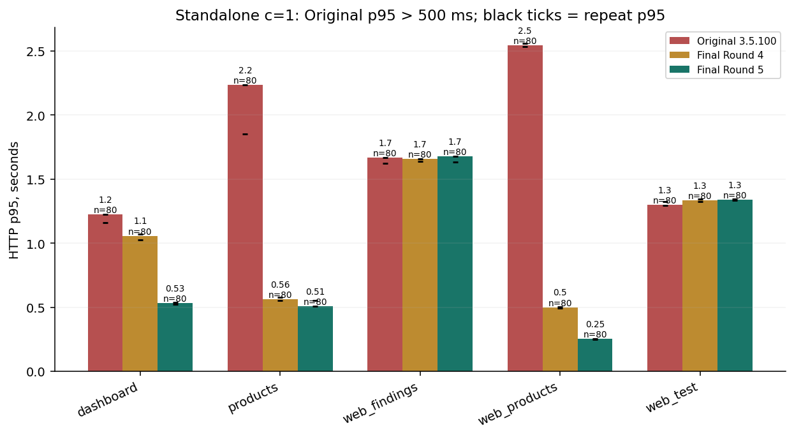
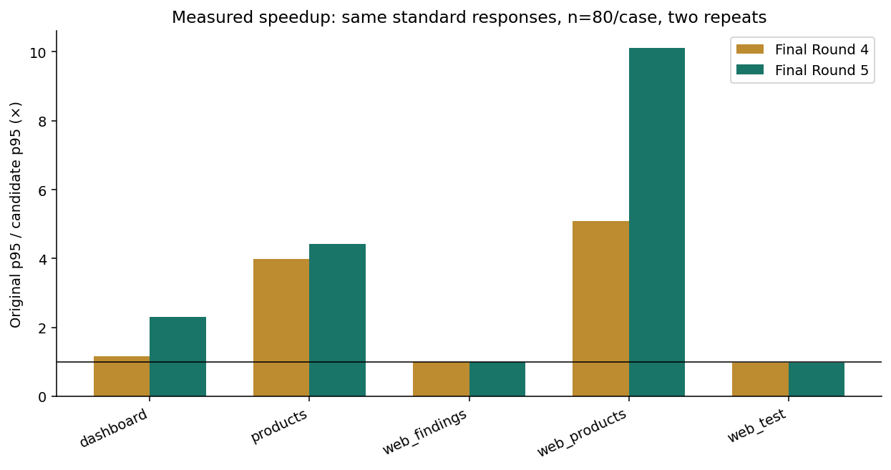
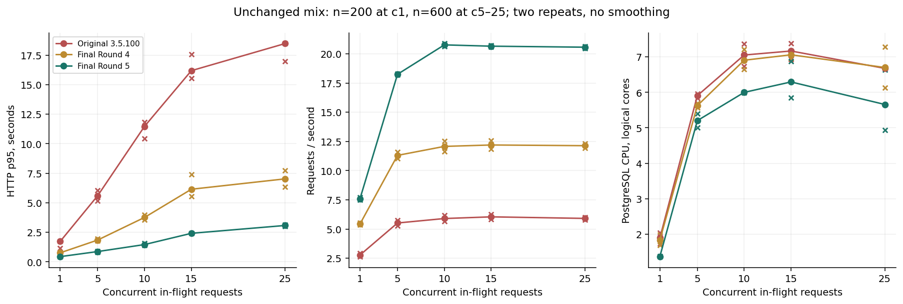
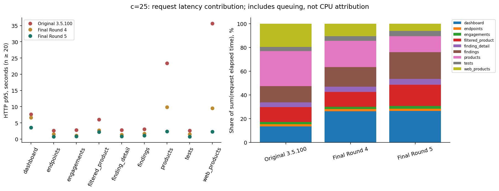
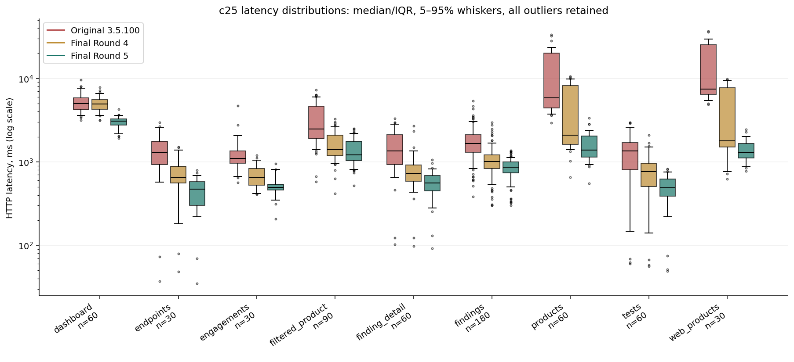
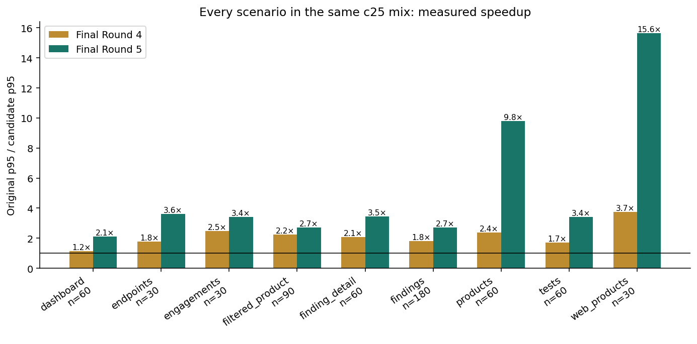
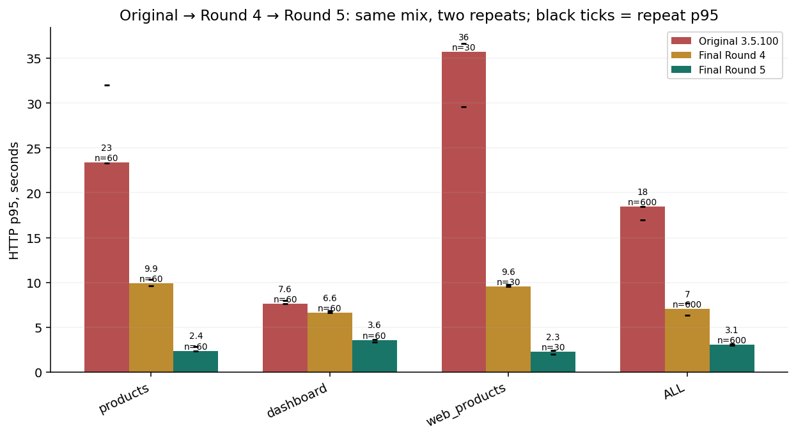
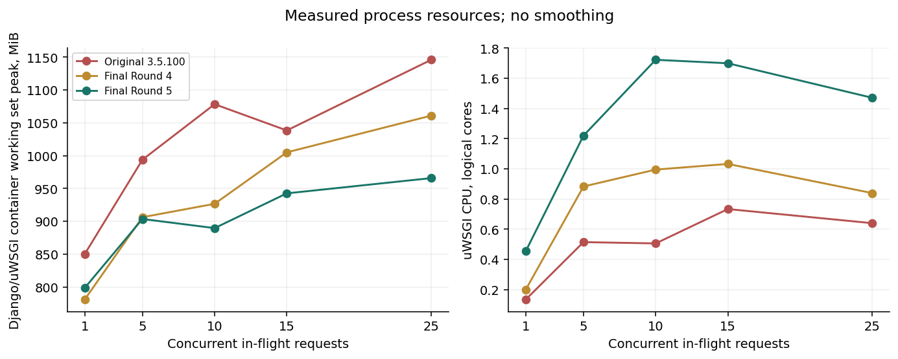

# Round 5 — результаты

## Для руководства

На одной базе с **1 000 168 findings** заново сравнены официальный DefectDojo OSS 3.5.100, завершённый Round 4 и финальный Round 5. В итоговое сравнение вошло **9720 измеренных HTTP-запросов**, отдельно от прогрева, SQL-диагностики и проверок ответов. Во всех выбранных сериях HTTP 200; ошибок 5xx — 0.

При c=25 общий mixed p95: **18.482 → 7.025 → 3.077 с**; throughput: **5.91 → 12.14 → 20.57 RPS**. Round 5 против свежего Round 4: p95 изменился на 56.2%, RPS — на 69.5%. Это результат двух оптимизаций в совокупности; эффект нельзя целиком приписать одному патчу.

Исторические 7.08 с / 11.94 RPS из Round 4 **не использованы** как новая контрольная группа. Основные таблицы используют только свежие запросы на одинаковой методике. Прогнозы для больших баз приведены отдельно.

## Конфигурация и воспроизводимость

Apple M5, 16 GiB RAM; Docker VM 10 CPU / 7.82 GiB. uWSGI 4 процесса × 4 потока. PostgreSQL 18.6, shared_buffers=128 MB, work_mem=4 MB; настройки не менялись. Нет новых индексов, миграций, сервисов или кэша. Точные лимиты, зависимости, power/swap, image IDs: [environment.json](environment.json), [source_verification.json](source_verification.json). Отсутствие индивидуальных лимитов контейнеров не означает отсутствие лимита Docker VM.

| Сборка | Git SHA | Проверено файлов dojo |
|---|---|---|
| Original 3.5.100 | `334bef02d65a74909fe976b22724526474d5a0f6` | 2189 |
| Final Round 4 | `716efb463387f82a0d13d5eae2541ac6b7dfee96` | 2190 |
| Final Round 5 | `c6a6144ed93b83adb1fd4ea9daa2c5e417ecea37` | 2190 |

Ветка `codex/performance-round5` продолжает отдельную release-normalized ветку 3.5.100, содержащую origin/dev в ancestry. Рабочая функциональная ветка и её пользовательские файлы не перезаписывались. Все Round 1–4 патчи сохранены. Port 8080 не использовался как оптимизированный вариант. Один тестовый web-контейнер за раз, без миграций/Celery beat над общей БД. Domain findings неизменны: count, sum ID, полный row-hash XOR и max_updated совпали до/после и с сохранённым seed; исходные 1 000 000 ID остались на месте.

## Методика

Фиксированный прежний mix: Findings list 30%, Product/severity/active filter 15%, Finding detail 10%, **полный Products API** 10%, Tests 10%, Engagements 5%, Dashboard 10%, Products UI 5%, Endpoints 5%. Page size 100; lightweight/FAST режимы отдельно в регрессиях. Один существующий admin + 24 существующих Product-scoped reader, одинаковый seeded schedule; c означает число запросов в полёте. Это не испытание 25 независимых людей с think time.

Прогрев 25 запросов; c1: 2×100, c5/10/15/25: 2×300. Порядок ABC/CBA, seeds 35101/35102, AC питание, low power mode off. Таймаут 90 с, ограничение серии 300 с, автоматический resource guard. Для standalone endpoints — тот же пул аккаунтов, два повтора по 40 запросов, прогрев 5. Все наблюдения и индивидуальные значения повторов сохранены. p95 рассчитан по объединённым latency, p99 только при n≥300; среднее p95 не используется. Малые per-case выборки (например 30 UI-запросов в mix) имеют высокий разброс; standalone серия даёт отдельные 80 наблюдений.

[REPRODUCE.md](REPRODUCE.md) содержит команды; [benchmark_results.json](benchmark_results.json) / [CSV](benchmark_results.csv) — численные результаты. Контейнерные CPU/working set — выборочные измерения. Унаследованный worker-RSS sampler пропускал PID1 worker и захватывал logger: старые primary RSS в JSON отмечены только как нижняя граница наблюдённых дочерних процессов. Исправленный сборщик измеряет все четыре workers по procname в отдельном парном c25 диагностическом прогоне; HTTP/SQL/buffer и Docker whole-container telemetry от ошибки не зависели. PG buffer reads не доказывают физическое чтение SSD: track_io_timing выключен.

## Две реализованные оптимизации

**1. Products, один авторизованный Product на странице.** Старый GROUP BY соединял каждую Finding с Test/Engagement; для Product с 532 569 активными findings план посещал одни heap pages восемь раз через Nested Loop/Bitmap Heap Scan. Теперь grouping key — уже известный Product ID, а Test IDs читаются одним ARRAY-подзапросом. Предыдущий Round 3 lookup перенесён в общий ORM helper без изменения SQL Finding-фильтра. Для нескольких Products сохранён batch GROUP BY. Полный упорядоченный ID-массив, точный active count и фильтры/доступ сохранены; это не замена ответом `findings=count`.

**2. Dashboard.** Три точных счётчика используют DISTINCT PK вместо всех Finding-полей. Три chart-агрегата (severity totals, month, punchcard day) заменены одним GROUP BY local day/severity. Небольшой агрегированный результат используется для всех графиков, без загрузки Finding objects. Сохранены cutoff, timezone, будущие даты, unknown severity, исключение duplicate и punchcard range. Старые публичные helper-функции оставлены; прочие вызовы punchcard работают прежним путём.

Изменены `dojo/product/queries.py`, `dojo/product/api/views.py`, `dojo/query_utils.py`, `dojo/finding/api/filters.py`, `dojo/home/views.py`, `dojo/utils.py`; добавлен `unittests/test_round5_performance.py`. Функциональные Engagements, UI redesign и шаблоны не менялись.

## SQL-профилирование и планы

pg_stat_statements не включён (shared_preload_libraries пуст, extension не установлена). Сервер не перезапускался. [sql_ranking_r4.json](sql_ranking_r4.json) и [sql_ranking_round5.json](sql_ranking_round5.json) содержат calls, total/mean/p95 **driver wall time**, rows и SQL shape без bindings. Диагностический лог включает прогрев/readiness; это не сервер-only execution time. Совокупные per-query shared/temp counters и server SQL p95 недоступны. Их нельзя подменять цифрами EXPLAIN или умножением одного плана на calls.

Фактические quiet SELECT планы: [phases_round4.json](phases_round4.json), [phases_round5.json](phases_round5.json). В них сохранены полные SQL без bindings и EXPLAIN ANALYZE/BUFFERS, включая Actual Rows/Loops, shared hits/reads и temp blocks.

### Final Round 4: самые дорогие SQL в c25 диагностике

| SQL shape ID | Calls | Σ driver с | Mean мс | p95 мс | Returned rows |
|---|---|---|---|---|---|
| 24240be45299207f | 29 | 80.42 | 2773.07 | 8267.95 | 29 |
| 7c5bec7658fcc91a | 31 | 42.59 | 1373.94 | 1917.08 | 155 |
| f071dbbc164900be | 14 | 40.42 | 2887.07 | N/A | 14 |
| 431eceff0aeb20cb | 31 | 26.60 | 857.95 | 1793.13 | 31 |
| 968eefcc030a9c63 | 45 | 26.53 | 589.60 | 1275.77 | 45 |
| afbe80b8829c539e | 31 | 21.92 | 706.99 | 1608.83 | 31 |
### Final Round 5: самые дорогие SQL в c25 диагностике

| SQL shape ID | Calls | Σ driver с | Mean мс | p95 мс | Returned rows |
|---|---|---|---|---|---|
| db96b7ff31a711fc | 31 | 41.44 | 1336.63 | 1677.27 | 155 |
| 968eefcc030a9c63 | 45 | 25.89 | 575.31 | 1318.03 | 45 |
| 1bcf069a654fa3ae | 29 | 24.39 | 841.08 | 1495.05 | 29 |
| e8e44f5b57f38230 | 31 | 19.14 | 617.57 | 806.30 | 31 |
| b7470d05a930fe99 | 98 | 14.10 | 143.92 | 248.46 | 98 |
| 93bdb24cf53ecf79 | 14 | 10.71 | 765.13 | N/A | 14 |
| Build | Actor | SELECT | PG execution ms | Shared hits | Shared reads | Temp written blocks | Rows |
|---|---|---|---|---|---|---|---|
| round4 | 1 | products SQL1 | 448.71 | 3 | 422808 | 1184 | 1.0 |
| round4 | 1 | web_products SQL1 | 402.53 | 3 | 422808 | 0 | 1.0 |
| round4 | 0 | dashboard SQL1 | 187.60 | 16038 | 109323 | 18966 | 1.0 |
| round4 | 0 | dashboard SQL2 | 84.34 | 15906 | 109301 | 0 | 5.0 |
| round4 | 0 | dashboard SQL3 | 388.71 | 16113 | 109078 | 2887 | 5.0 |
| round4 | 0 | dashboard SQL4 | 179.40 | 16024 | 109245 | 2221 | 1.0 |
| round5 | 1 | products SQL1 | 230.45 | 11 | 125246 | 787 | 1.0 |
| round5 | 1 | web_products SQL1 | 205.24 | 11 | 125246 | 0 | 1.0 |
| round5 | 0 | dashboard SQL1 | 88.19 | 15810 | 109457 | 0 | 1.0 |
| round5 | 0 | dashboard SQL2 | 305.48 | 15980 | 109211 | 0 | 5.0 |

Отдельные пробные SQL-планы и отклонённые пути сохранены в raw: добавление ARRAY при сохранении внешнего Finding→Test JOIN не устраняло повторные heap scans; обычный IN также выбирал старый Nested Loop. Промежуточное удаление внешнего DISTINCT у трёх отдельных chart-запросов дало регрессию c25. Вариант только с узкими счётчиками ускорил Products, но не общий p95: три полных прохода Dashboard оставались пределом. Эти завершённые/остановленные exploratory серии архивированы в `raw/rejected-chart-plan/` и `raw/counts-only-candidate/`, исключены из финального сравнения. Итоговый общий дневной агрегат проверен отдельно и входит в FINAL.

## Основной mixed workload

| Build | c | n | p50 с | p90 с | p95 с | p99 с | RPS | PG CPU cores | uWSGI CPU cores | App working set MiB |
|---|---|---|---|---|---|---|---|---|---|---|
| Original 3.5.100 | 1 | 200 | 0.127 | 1.112 | 1.727 | N/A | 2.77 | 1.89 | 0.13 | 850.10 |
| Final Round 4 | 1 | 200 | 0.097 | 0.572 | 0.762 | N/A | 5.44 | 1.83 | 0.20 | 781.00 |
| Final Round 5 | 1 | 200 | 0.098 | 0.407 | 0.440 | N/A | 7.60 | 1.37 | 0.45 | 798.60 |
| Original 3.5.100 | 5 | 600 | 0.256 | 1.993 | 5.596 | 8.444 | 5.52 | 5.91 | 0.51 | 993.80 |
| Final Round 4 | 5 | 600 | 0.208 | 1.534 | 1.844 | 2.266 | 11.31 | 5.63 | 0.88 | 906.30 |
| Final Round 5 | 5 | 600 | 0.191 | 0.731 | 0.869 | 1.040 | 18.25 | 5.20 | 1.22 | 903.60 |
| Original 3.5.100 | 10 | 600 | 0.356 | 3.094 | 11.471 | 17.302 | 5.90 | 7.06 | 0.51 | 1078.27 |
| Final Round 4 | 10 | 600 | 0.330 | 2.692 | 3.758 | 5.145 | 12.08 | 6.91 | 1.00 | 926.70 |
| Final Round 5 | 10 | 600 | 0.333 | 1.200 | 1.461 | 1.805 | 20.77 | 6.00 | 1.72 | 889.70 |
| Original 3.5.100 | 15 | 600 | 0.445 | 4.533 | 16.186 | 25.947 | 6.04 | 7.17 | 0.73 | 1038.34 |
| Final Round 4 | 15 | 600 | 0.406 | 3.884 | 6.145 | 8.373 | 12.20 | 7.06 | 1.03 | 1005.00 |
| Final Round 5 | 15 | 600 | 0.494 | 1.840 | 2.414 | 2.763 | 20.66 | 6.30 | 1.70 | 942.60 |
| Original 3.5.100 | 25 | 600 | 2.036 | 6.347 | 18.482 | 29.565 | 5.91 | 6.68 | 0.64 | 1145.86 |
| Final Round 4 | 25 | 600 | 1.118 | 5.001 | 7.025 | 9.602 | 12.14 | 6.70 | 0.84 | 1060.86 |
| Final Round 5 | 25 | 600 | 0.911 | 2.383 | 3.077 | 3.514 | 20.57 | 5.66 | 1.47 | 965.80 |

### PostgreSQL, выборочные окна c25 primary mix

| Build/run | PG CPU peak % | Active peak | IO wait peak | Lock wait peak | Shared reads Δ | Shared hits Δ | Temp bytes Δ | Celery queue peak |
|---|---|---|---|---|---|---|---|---|
| mixed-r1-original-c25-mixed.json | 826.79 | 22 | 13 | 0 | 38383423 | 15695657 | 1662582784 | 0 |
| mixed-r1-round4-c25-mixed.json | 833.00 | 21 | 9 | 0 | 18041616 | 6564969 | 1550630912 | 0 |
| mixed-r1-round5-c25-mixed.json | 677.49 | 18 | 10 | 0 | 8689665 | 4273230 | 77799424 | 0 |
| mixed-r2-original-c25-mixed.json | 818.60 | 23 | 13 | 0 | 35136517 | 19004485 | 1032388608 | 0 |
| mixed-r2-round4-c25-mixed.json | 783.04 | 22 | 11 | 0 | 17359454 | 7941945 | 858529792 | 0 |
| mixed-r2-round5-c25-mixed.json | 715.89 | 19 | 10 | 0 | 6008103 | 3484873 | 38535168 | 0 |

Это глобальные счётчики source DB между первой/последней выборкой внутри серии: окно неполное, stats flush асинхронен, атрибуции отдельному SQL нет. Celery в этих read-only сериях не выполнял новые импорты; нулевая очередь не является проверкой его throughput. PG CPU и IO waits показывают смешанный CPU/IO/буферный предел, а не доказательство исключительно CPU-bound нагрузки.

### Разброс повторов, mixed c25

| Build | Повтор | n | p95 с | RPS |
|---|---|---|---|---|
| Original 3.5.100 | 1 | 300 | 16.959 | 6.01 |
| Original 3.5.100 | 2 | 300 | 18.482 | 5.81 |
| Final Round 4 | 1 | 300 | 6.361 | 12.33 |
| Final Round 4 | 2 | 300 | 7.722 | 11.95 |
| Final Round 5 | 1 | 300 | 3.118 | 20.66 |
| Final Round 5 | 2 | 300 | 3.026 | 20.49 |

### c25, вклад отдельных маршрутов в тот же mix

| Scenario | n/build | Original p95 с | Round4 p95 с | Round5 p95 с | R5 share Σ request elapsed |
|---|---|---|---|---|---|
| dashboard | 60 | 7.637 | 6.630 | 3.595 | 26.3% |
| endpoints | 30 | 2.662 | 1.493 | 0.738 | 2.0% |
| engagements | 30 | 2.761 | 1.112 | 0.811 | 2.2% |
| filtered_product | 90 | 6.037 | 2.688 | 2.215 | 18.1% |
| finding_detail | 60 | 2.825 | 1.358 | 0.818 | 4.9% |
| findings | 180 | 3.036 | 1.680 | 1.125 | 22.4% |
| products | 60 | 23.375 | 9.880 | 2.383 | 13.6% |
| tests | 60 | 2.594 | 1.503 | 0.757 | 4.3% |
| web_products | 30 | 35.700 | 9.550 | 2.283 | 6.2% |

### Standalone c1, одинаковые полные ответы

| Scenario | n/build | Original p95 с | Round4 p95 с | Round5 p95 с | Original/R5 | SQL Original/R4/R5 |
|---|---|---|---|---|---|---|
| dashboard | 80 | 1.223 | 1.057 | 0.533 | 2.30× | 18.0 / 17.0 / 15.0 |
| products | 80 | 2.235 | 0.561 | 0.506 | 4.41× | 10.0 / 10.0 / 10.0 |
| web_findings | 80 | 1.666 | 1.658 | 1.679 | 0.99× | 60.0 / 60.0 / 60.0 |
| web_products | 80 | 2.545 | 0.500 | 0.252 | 10.11× | 24.0 / 25.0 / 25.0 |
| web_test | 80 | 1.301 | 1.332 | 1.337 | 0.97× | 76.0 / 76.0 / 76.0 |

### Корректный sampled RSS всех четырёх workers, парный c25 контроль

| Build | Samples, 0.4 s interval | Max observed worker RSS MiB |
|---|---|---|
| round4 | 59 | 324.70 |
| round5 | 36 | 295.42 |

### Полный Products API: отдельная серия

| Build | c | n | p50 с | p90 с | p95 с | RPS | Median bytes | App working set MiB | Observed worker RSS MiB | RSS scope |
|---|---|---|---|---|---|---|---|---|---|---|
| Original 3.5.100 | 1 | 80 | 0.623 | 1.875 | 2.235 | 0.86 | 195445 | 1425.41 | 537.91 | legacy lower bound |
| Final Round 4 | 1 | 80 | 0.070 | 0.543 | 0.561 | 3.72 | 195445 | 732.10 | 324.45 | legacy lower bound |
| Final Round 5 | 1 | 80 | 0.079 | 0.297 | 0.506 | 5.41 | 195445 | 834.80 | 330.25 | legacy lower bound |
| Original 3.5.100 | 5 | 80 | 1.137 | 5.473 | 5.713 | 1.70 | 195445 | 1384.45 | 491.83 | all 4 |
| Final Round 4 | 5 | 80 | 0.211 | 1.592 | 1.690 | 6.98 | 195445 | 789.00 | 339.16 | all 4 |
| Final Round 5 | 5 | 80 | 0.172 | 0.496 | 0.627 | 15.23 | 195445 | N/A | 372.39 | all 4 |
| Original 3.5.100 | 10 | 80 | 1.751 | 9.264 | 9.680 | 1.81 | 195445 | 1421.31 | 460.21 | all 4 |
| Final Round 4 | 10 | 80 | 0.386 | 2.269 | 2.358 | 8.55 | 195445 | 1004.00 | 371.22 | all 4 |
| Final Round 5 | 10 | 80 | 0.341 | 0.739 | 0.812 | 18.17 | 195445 | N/A | 334.34 | all 4 |
| Original 3.5.100 | 25 | 80 | 10.203 | 14.461 | 15.438 | 2.07 | 195445 | 1530.88 | 463.84 | all 4 |
| Final Round 4 | 25 | 80 | 1.567 | 3.745 | 3.771 | 9.61 | 195445 | 1130.50 | 406.05 | all 4 |
| Final Round 5 | 25 | 80 | 0.929 | 1.587 | 1.650 | 19.02 | 195445 | N/A | 367.89 | all 4 |

N/A для Docker memory означает отсутствие выборки внутри очень короткой measured-фазы; такие данные не восстановлены оценкой. Worker RSS имеет отдельный sampler и scope. Состав payload зависит от авторизованного Product. Поэтому медианный размер в общей серии не равен максимальному ответу администратора. Для диагностической декомпозиции отдельного запроса:

| Build | Actor | IDs | Bytes | SQL ms | ID load incl SQL ms | Representation ms | JSON render ms | Sampled RSS increase MiB |
|---|---|---|---|---|---|---|---|---|
| round4 | 0 | 840362 | 5800448 | 485.77 | 497.48 | 1.49 | 15.90 | 72.84 |
| round4 | 1 | 532569 | 3669647 | 492.74 | 497.15 | 0.71 | 11.27 | 19.25 |
| round4 | 9 | 28143 | 194707 | 42.76 | 36.88 | 0.62 | 0.52 | 0.02 |
| round4 | 17 | 28243 | 195445 | 47.04 | 41.05 | 0.66 | 0.54 | 0.02 |
| round5 | 0 | 840362 | 5800448 | 486.59 | 498.31 | 1.47 | 15.94 | 67.33 |
| round5 | 1 | 532569 | 3669647 | 244.49 | 248.97 | 0.65 | 10.36 | 19.20 |
| round5 | 9 | 28143 | 194707 | 45.77 | 40.37 | 0.63 | 0.51 | 0.02 |
| round5 | 17 | 28243 | 195445 | 42.04 | 36.64 | 0.61 | 0.53 | 0.02 |

### UI phases, admin diagnostic (inclusive times, ms)

| Build | Page | Wall | SQL | Queryset eval incl SQL | Template incl SQL | Template SQL subset | Chart helpers incl SQL |
|---|---|---|---|---|---|---|---|
| round4 | web_products | 669.67 | 139.01 | 142.78 | 504.18 | 5.34 | 0.00 |
| round4 | dashboard | 864.42 | 848.06 | 631.88 | 4.59 | 0.98 | 630.53 |
| round4 | web_findings | 1700.10 | 1588.47 | 1588.66 | 1590.76 | 1486.25 | 0.00 |
| round4 | web_test | 1158.39 | 1050.09 | 504.01 | 990.71 | 893.65 | 0.00 |
| round5 | web_products | 498.92 | 136.63 | 140.52 | 334.99 | 4.12 | 0.00 |
| round5 | dashboard | 418.37 | 407.35 | 305.98 | 4.39 | 0.95 | 304.12 |
| round5 | web_findings | 1711.45 | 1597.75 | 1594.63 | 1595.84 | 1491.21 | 0.00 |
| round5 | web_test | 1148.12 | 1040.63 | 501.07 | 979.97 | 883.52 | 0.00 |

Фазы измерены диагностически, а не как p95; `ID load` включает SQL и декодирование/материализацию ID. Inclusive template time в тех же JSON включает ленивое выполнение ORM; складывать его с SQL как независимые фазы нельзя. RSS sampled каждые 10 ms — нижняя граница пика, предыдущие запросы могут переиспользовать память. Все SQL/phase/response/RSS значения сохранены, включая шумные cold-process значения; небольшие колебания не объявляются ускорением.

Стандартный ответ администратора содержит 840 362 ID / 5 800 448 bytes, тяжёлый scoped Product — 532 569 ID / 3 669 647 bytes. Размер не уменьшался. В источниках не найден подтверждённый внутренний потребитель именно Product API findings_list; одноимённые переменные Findings templates относятся к другому контексту. Products UI уже считает числа напрямую и не загружает этот API-массив. Для внешних клиентов необходима инвентаризация интеграций; режимы count/none можно выбирать только при отсутствии потребности в IDs. Сам benchmark остался полным.

## Цели c25

| Цель | Достигнута в этих сериях | Измерено |
|---|---|---|
| Mixed p95 <4 s | да | 3.077 s |
| Mixed RPS >15 | да | 20.57 |
| Full Products p95 <5 s, внутри mix | да | 2.383 s |
| Dashboard p95 <3 s, внутри mix | нет | 3.595 s |
| HTTP 5xx =0 | да | 0 |

Цели не использовались для изменения весов workload, прав, точности COUNT или состава ответов. Два повтора показывают локальный разброс, но не являются production SLO/доверительным интервалом на длительную эксплуатацию.

## Графики

Чёрные/крестообразные отметки — значения повторов, подписи содержат n. Нет сглаживания. Вклады latency учитывают очередь и перекрывающиеся запросы; это не разложение CPU. [RPS](charts/critical_rps.png), [SQL](charts/critical_sql.png). Все графики строятся `plot_results.py` из JSON.

## Корректность и оставшиеся пределы

**104 теста: 96 pass, 8 skip, 0 fail.** Новые четыре regression tests проверяют полный sorted ID-массив, active/verified counts, пустой Product, multi-product path, count/none, hidden Product, PK DISTINCT при двух risk acceptances и исключение duplicates; chart oracle покрывает cutoff/future/unknown severity/UTC и America/New_York. Предыдущие тесты включают FAST/default/custom ordering, CSV Product filters, Finding/Jira prefetch и несколько реальных vulnerability references. Полные сравнения HTTP: **196 пар, 0 semantic/JSON/status расхождений**. Opt-in режимы сравниваются только Round4→Round5. Динамические HTML bytes не трактуются как data regression; сравнивается серверный контекст. Логи/проверки перечислены в [TEST_RESULTS.md](TEST_RESULTS.md).

Изменения не затрагивают import/reimport/deduplication; реальные write-нагрузки Round 4 не выдаются за новые Round 5 испытания. Синтетический миллион не представляет все production relationships и сигналы. Не подтверждены новая длительная production soak, 25 независимых людей/интеграций, HA PostgreSQL, 5–20 млн реальных findings.

1. Dashboard теперь читает таблицу меньше раз, но точные totals/daily aggregate всё ещё линейны по разрешённым findings; PG CPU/сканирование остаются пределом. Следующее решение — спроектировать точные Product/day агрегаты с транзакционной актуализацией и проверкой прав, затем отдельно измерить import/write cost. В текущем патче такого кэша/денормализации нет.
2. Полные Product ID arrays линейно растут по CPU, памяти и сети. Обратная совместимость не позволяет ограничить ответ. Практический следующий шаг — перевести проверенные summary-клиенты на существующие opt-in режимы, для IDs спроектировать opt-in пагинированный ID-only endpoint с прежними проверками доступа; такого нового endpoint в патче нет. Полный стандартный путь останется дорогим. Покрывающий partial index можно лишь исследовать на копии после EXPLAIN и оценки write/storage cost; он не добавлен.
3. Findings UI и Test UI сохраняют широкие DISTINCT counts/повторные агрегаты. Они измерены и задокументированы в phases, но оставлены за лимитом двух оптимизаций. Глубокий OFFSET и точный count стандартной пагинации также остаются; FAST не включён глобально.
4. Увеличение c после точки CPU saturation повышает очередь; текущие графики не доказывают capacity будущих 16 vCPU/32 GiB application nodes и внешнего HA PG. Нужен отдельный end-to-end тест с импортами, штатными отношениями и длительным soak.

## Прогноз, не измерения

Текущая БД занимает 3.37 GB; Finding heap+indexes — 2.20 GB. Грубое линейное масштабирование структуры синтетической БД даёт около 16.8/33.7/67.3 GB для 5/10/20 млн; media, WAL, replicas, backups, настоящие scanner evidence/relations и write bloat могут существенно увеличить footprint. Это не sizing production.

При сохранении нынешней active доли полный общий Product response при одинаковом числе bytes на ID линейно вырастет до 29/58/116 MB для 5/10/20 млн total findings. С учётом роста числа цифр последовательных ID оценка составляет примерно 33/66/142 MB (при неизменной active-доле); это модель, не эксперимент. Python int/list и промежуточные буферы также растут линейно; параллельные полные ответы способны исчерпать RAM application-ноды. Эти оценки не являются замерами больших баз. Автоматический 5-миллионный seed не запускался.

## Внедрение и rollback

Готовы два локально проверенных ORM-патча, тесты и воспроизводимый suite; production readiness требует отдельного representative/load/HA испытания. Новых миграций нет. Развёртывать проверенный immutable image, сначала canary с проверкой полного payload/permissions и PostgreSQL CPU/temp/latency; lightweight режимы включать только клиентским opt-in. [ROLLBACK.md](ROLLBACK.md): вернуть Round4 image или отдельно restore Product ORM group / Dashboard view+utils. БД откатывать, удалять или пересоздавать не требуется.
