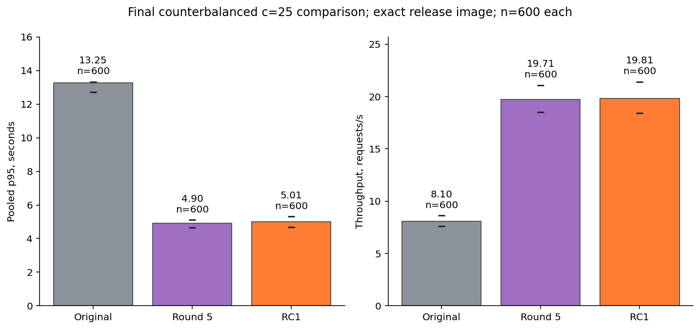
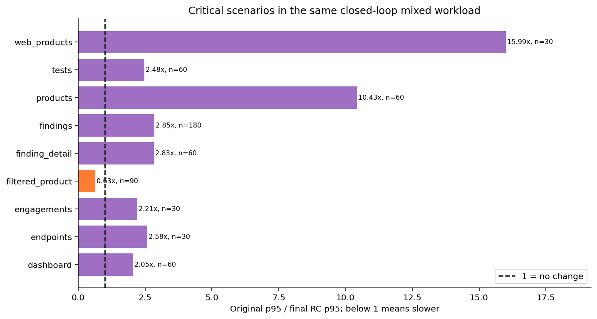
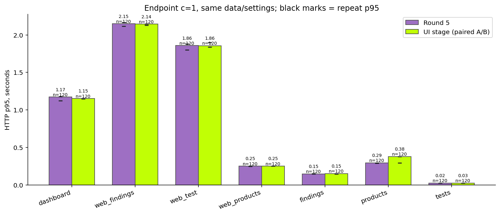
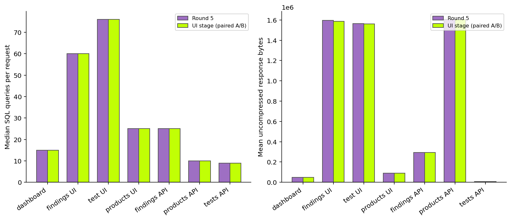
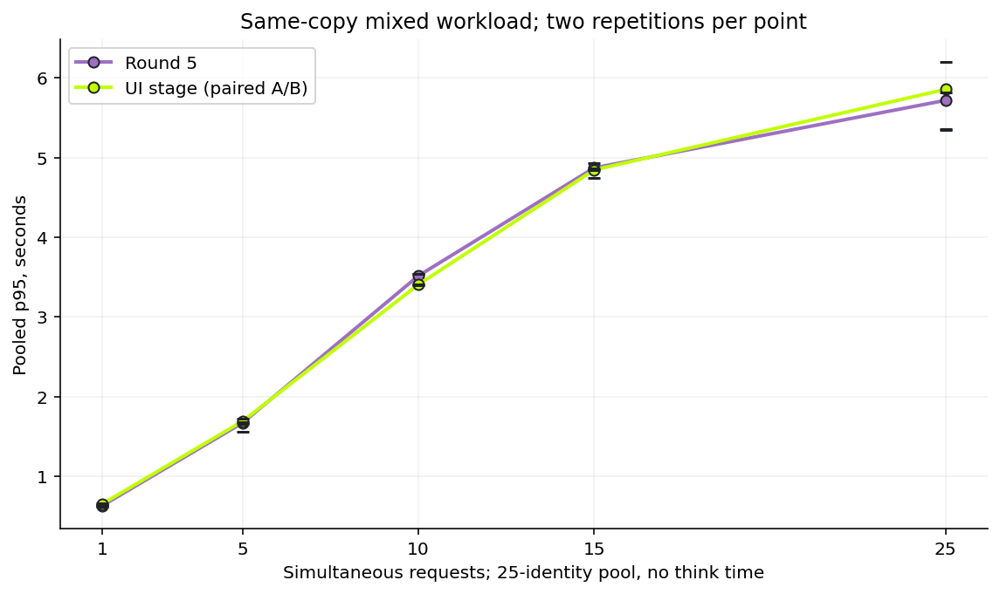
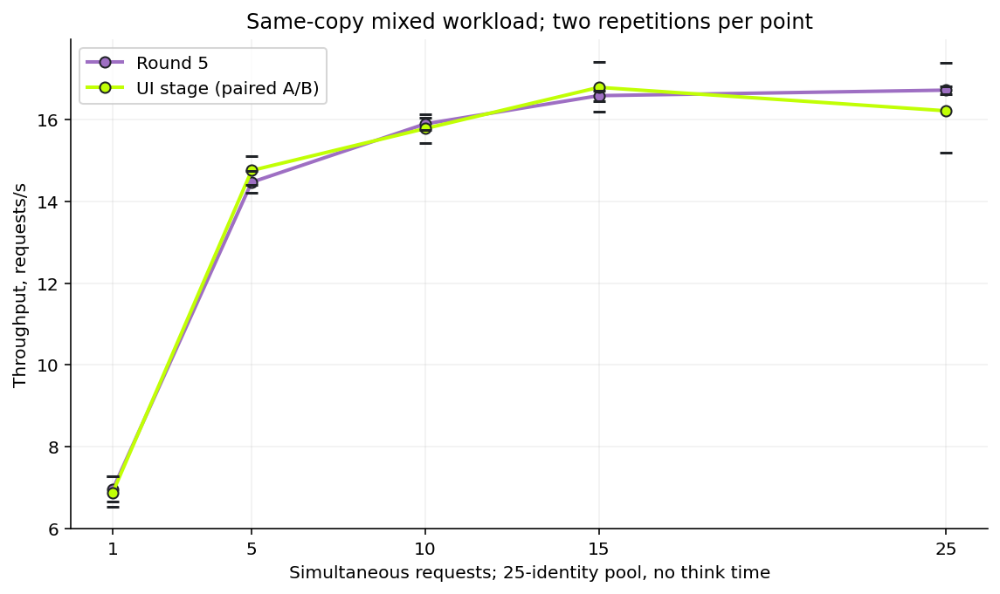
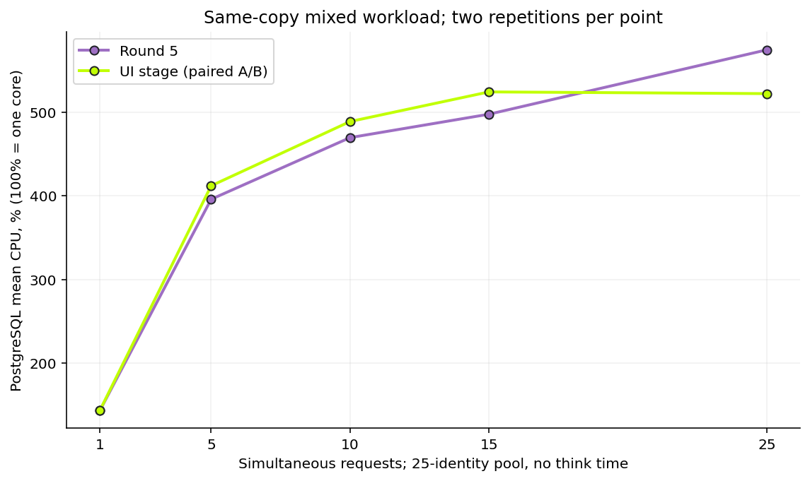
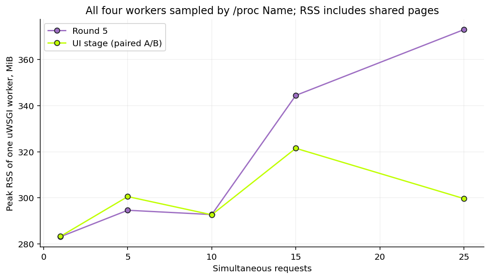
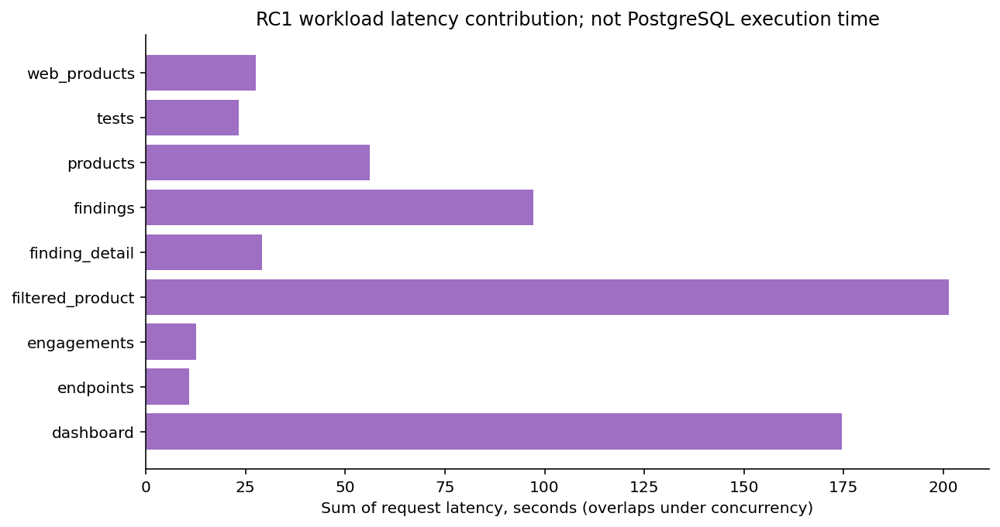

> RC2: см. [RC2_PERFORMANCE.md](RC2_PERFORMANCE.md). Ниже сохранён исторический отчёт RC1; его цифры/открытые дефекты не подменяют новую проверку.

# ASPM 1.0.1 RC1 — производительность

Финальный application SHA: `5cdbc77fc9d4b8d0899069f5d44cd5241b2acae6`. На одинаковых данных **1 000 168 findings** финальный контрбалансированный c=25 тест дал p95 **13.253 → 5.013 с**, throughput **8.10 → 19.81 RPS** (×2.45). Это эффект накопленных Round 1–5 относительно исходного DefectDojo, не ускорение от смены цветов.

Сравнение с Round 5 в той же финальной серии: p95 4.904 → 5.013 с (+2.2%), RPS 19.71 → 19.81. Разница p95 находится в диапазоне межсерийного разброса. Два повтора не являются формальным доказательством эквивалентности или production capacity.

## Методика и данные

Apple M5 / 16 GiB; Docker 10 CPU, 7.82 GiB VM. PostgreSQL 18.6, shared_buffers=128MB, work_mem=4MB; Python 3.14.8, Django 5.2.17, DRF 3.18.3. uWSGI 4×4. Серверные параметры не подбирались под UI.

Смешанная нагрузка зафиксирована до тестов: Findings list 30%, Product/severity/active filter 15%, Finding detail 10%, **full Products** 10%, Tests 10%, Engagements 5%, Dashboard 10%, Products UI 5%, Endpoints 5%. Страница API 100. `findings=count/none` и FAST в эту смесь не входят; проверяются отдельно на совместимость.

25 существующих identities (1 admin +24 scoped readers), нулевой think time. Concurrency — одновременно выполняемые запросы, а не сертифицированные 25 независимых человеческих пользователей. Прогрев 25, 300 measured requests на серию, 2 повтора, seeds35101/35102, timeout90s/deadline360s. Финальный порядок Original→Round5→RC, затем RC→Round5→Original. Один порт48086 и одна БД `dd_round4_seed`, никакие migrations/workers/imports над seed не запускались. GET может обновлять session-данные; контрольные суммы Finding до/после совпали.

Раннее R5/UI A/B использовало отдельную копию `aspm_rc1_validation` до write tests, те же 1 000 168 строк и совпадающие полные fingerprints: endpoint c1 2×60 запросов, saturation c1/5/10/15/25 2×300. Финальная тройка отделена от этих серий. Всего в сохранённых завершённых load-сериях **10 680 measured HTTP requests, все200**; прогрев/readiness, browser и 300 запросов import-read сюда не включены. Нельзя объединять p95 разных фаз.

Исторические Original18.482с/5.91RPS → R53.077с/20.57RPS сохранены в исходном Round5 отчёте. Это другая серия; она не подставлена в новые таблицы. Первый прерванный сном Mac прогон сохранён в raw/interrupted-window и исключён. На повторных сериях использовалось AC/caffeinate и resource guard.

## Финальная тройка, c=25

| Build | n | p50 s | p90 s | p95 s | p99 s | RPS | PG mean CPU % | App mean CPU % | Peak worker RSS MiB |
|---|---:|---:|---:|---:|---:|---:|---:|---:|---:|
| Original3.5.100 | 600 | 1.126 | 4.033 | 13.253 | 20.568 | 8.10 | 522.0 | 42.7 | 338.2 |
| Round5 | 600 | 0.612 | 1.462 | 4.904 | 7.425 | 19.71 | 515.9 | 109.9 | 288.6 |
| ASPM1.0.1RC1 | 600 | 0.654 | 1.440 | 5.013 | 7.044 | 19.81 | 539.2 | 94.7 | 313.9 |

CPU100%=одно логическое ядро. RSS измеряется у всех4 реальных uWSGI workers по /proc Name, включая PID1; shared pages могут учитываться несколько раз между процессами. Пик одного worker — не память отдельного запроса. Старые исторические R5 RSS с неполным sampler не используются.

## Сценарии внутри финального mixed workload

| Scenario | n/build | Original p95 s | Round5 p95 s | RC p95 s | Original/RC | SQL Original | SQL RC |
|---|---:|---:|---:|---:|---:|---:|---:|
| dashboard | 60 | 20.154 | 9.733 | 9.813 | 2.05× | 18 | 15 |
| endpoints | 30 | 1.885 | 0.644 | 0.732 | 2.58× | 5 | 5 |
| engagements | 30 | 1.448 | 0.651 | 0.656 | 2.21× | 9 | 9 |
| filtered_product | 90 | 3.425 | 5.265 | 5.393 | 0.63× | 124 | 25 |
| finding_detail | 60 | 2.097 | 0.739 | 0.742 | 2.83× | 24 | 24 |
| findings | 180 | 2.370 | 0.819 | 0.831 | 2.85× | 124 | 25 |
| products | 60 | 13.253 | 1.291 | 1.271 | 10.43× | 10 | 10 |
| tests | 60 | 1.885 | 0.665 | 0.761 | 2.48× | 9 | 9 |
| web_products | 30 | 20.568 | 1.401 | 1.286 | 15.99× | 24 | 25 |

**Не все сценарии стали быстрее:** filtered_product p95 хуже исходного в обеих R5/RC. У RC относительно R5 разница мала, но это остаточный риск. В closed-loop при одинаковом concurrency система после оптимизации обрабатывает больше запросов/сек, меняя конкуренцию за CPU; это возможное объяснение, не доказанный root cause этого различия. Нужен отдельный offered-load/SQL-plan тест. Не выдаём общий выигрыш за ускорение каждого маршрута. Full Products измерен стандартным ответом; pooled25 identities не равнозначны отдельному сценарию admin с миллионом IDs.

## Проверка после редизайна: endpoint c=1

UI stage SHA9b02c68ee2fcd789a99b1aa13e248b0266a6a055; последующие runtime изменения — позиция page-size меню, report metadata/cover и promo-gating UI. API/ORM/data visibility не изменены. Финальный source5cdbc отдельно проверен тройкой выше и compatibility/regression gates.

| Scenario | n/build | R5 p95 ms | UI p95 ms | R5 RPS | UI RPS | SQL R5/UI | Mean HTML/JSON bytes R5/UI |
|---|---:|---:|---:|---:|---:|---:|---:|
| dashboard | 120 | 1171.4 | 1152.2 | 2.15 | 2.16 | 15/15 | 49789/49178 |
| web_findings | 120 | 2148.4 | 2144.9 | 0.91 | 0.92 | 60/60 | 1596697/1586647 |
| web_test | 120 | 1858.6 | 1856.2 | 1.24 | 1.24 | 76/76 | 1564503/1560172 |
| web_products | 120 | 251.1 | 250.6 | 7.09 | 7.12 | 25/25 | 90782/89823 |
| findings | 120 | 147.8 | 151.1 | 12.13 | 12.31 | 25/25 | 292582/292582 |
| products | 120 | 294.1 | 379.1 | 6.19 | 6.12 | 10/10 | 1604571/1604571 |
| tests | 120 | 24.7 | 25.1 | 59.79 | 63.22 | 9/9 | 8117/8117 |

## Saturation и вклад запросов

Следующие curves — единая ранняя paired R5/UI saturation-серия на validation-копии до writes. Не смешаны с финальной тройкой на seed. Чёрные marks показывают отдельные повторные p95/RPS. Нет сглаживания. При c≥10 прирост throughput замедляется, p95 растёт; PG и приложение конкурируют за CPU локальной VM.

Latency contribution — сумма перекрывающихся request wall times с очередями, не исключительное SQL/CPU время.

## Browser/static

32 последовательные Chromium navigation measurements, по2 повтора cold/warm на4 страницах/2builds; все200, внешних resource origins нет. Это описательные samples, **не browser p95**. В cold cache очищен через CDP; warm — повтор той же страницы. Перед сравнением восстановлен корректный frozenR5 gateway со static и тем же gzip. API-only gateway48085 без static исключён.

| Page | Static requests R5/UI (cold) | Decoded static KiB R5/UI | Mean cold DOMContentLoaded ms R5/UI |
|---|---:|---:|---:|
| dashboard | 38/39 | 3591.4/3619.6 | 1546.9/754.1 |
| findings | 40/41 | 3503.6/3531.7 | 1906.3/1889.8 |
| products | 40/41 | 3503.6/3531.7 | 304.1/302.2 |
| test | 41/42 | 3508.5/3536.6 | 1379.1/1415.9 |

Только aspm.css/aspm.js и SVG/markup; новых runtime frameworks нет. Набор static байтов после последнего promo-only патча тот же. Размеры HTML отличаются оформлением; API JSON сравнивался полностью по SHA256, не только count/status.

## P2 и реальные import/reimport

Новых P2 performance-патчей **0**. [P2_AUDIT.md](P2_AUDIT.md) и [ui-phases.json](measurements/ui-phases.json) содержат SQL, EXPLAIN ANALYZE BUFFERS и вложенные фазы. Главные пределы — широкая выборка/сортировка severity, глобальный DISTINCT title с temp spill и точные агрегаты. Неподтверждённый COUNT-патч не внедрялся. Строгое сохранение порядка и состава title-limit ограничивает безопасный быстрый патч. Stretch goals не достигнуты и не являются условием RC.

| Operation | HTTP | Elapsed ms | Dedup complete |
|---|---:|---:|---|
| import | 201 | 1413.5 | True |
| reimport | 201 | 757.2 | True |
| duplicates | 201 | 902.9 | True |

Отдельная validation-копия, реальный ZAP API, worker1/prefetch1, 40 alerts×3URL, reimport4..43, затем peer. Подтверждены44 findings в primary, 4 mitigated, 40 duplicates у peer. На фоне — 300 read requests c5, statuses{'200': 300}, p95 1691.9ms. Это smoke/overlap, не причинная A/B оценка влияния импорта. Первичная инфраструктурная проба с пустым worker-prefetch не завершила async dedup; после исправления очередь обработана, 40 её строк сохранены только в копии. Валидный новый цикл представлен выше; первичная проба отдельно import-initial.

Background timings/SQL/RSS/queue samples: background-tasks.json и import-resources.jsonl. Task RSS — process high-water, не исключительный RSS задачи. Dedup temporarilyenabled onlycopy/restoredFalse; maillocmem исключает отправку наружу. Source/seed никогда не импортировались.

## Ограничения измерений

pg_stat_statements не включён. SQL count/time — одинаковый benchmark middleware, без bindings. Driver execute wall не равен чистому server execution; планы сняты отдельно безопасными SELECT. PG CPU измерен для всего cluster container; другие старые benchmark-apps остановлены, исходные app/worker остались idle. Buffers/temp/connections — sampled per-DB counters, а не per-query totals. Первая final Original resource-серия имела неверный per-DB scope: её DB counters исключены, CPU/RSS/HTTP корректны; для PG counters доступны остальные серии. Полные сырые поля сохранены без замалчивания.

Saturation/JSON и CSV: [benchmark_results.json](benchmark_results.json), [benchmark_results.csv](benchmark_results.csv), сырые timings/resources в measurements/raw. На 5/10/20 млн ничего не генерировалось: выводы о production или конкурентах не делаются. Нужны отдельные инфраструктурные испытания; full Product IDs, exact COUNT и CPU-bound aggregation остаются ограничениями.
