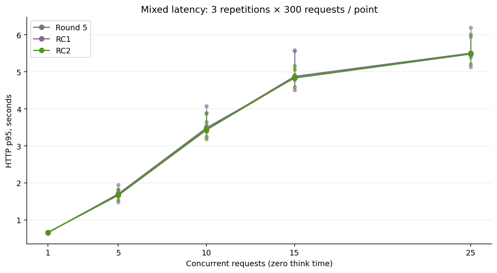
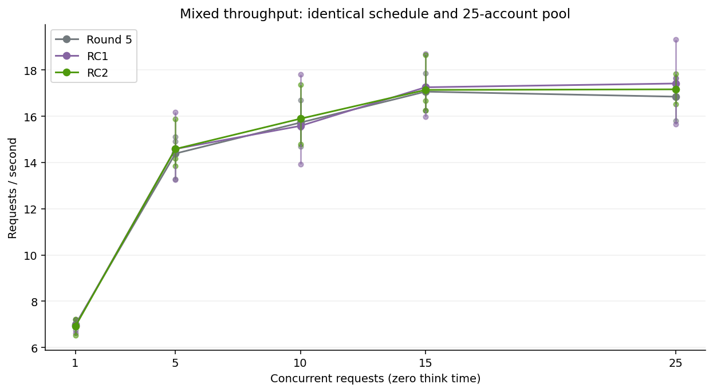
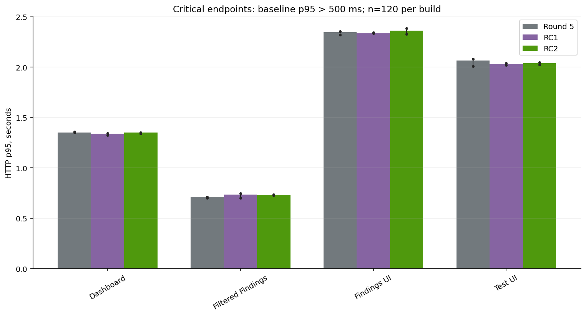
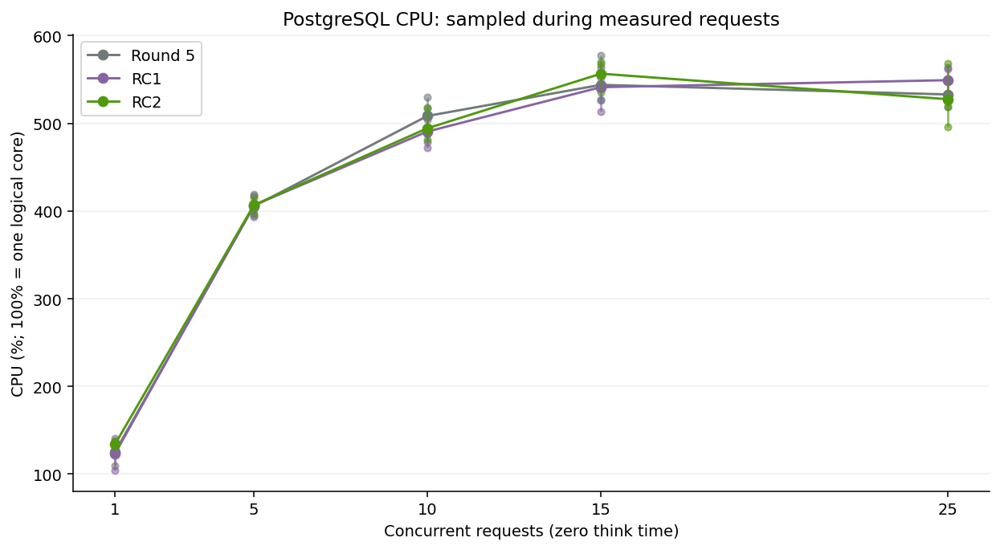
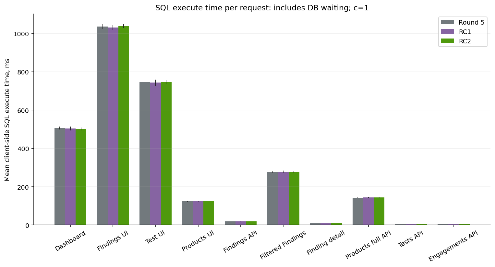
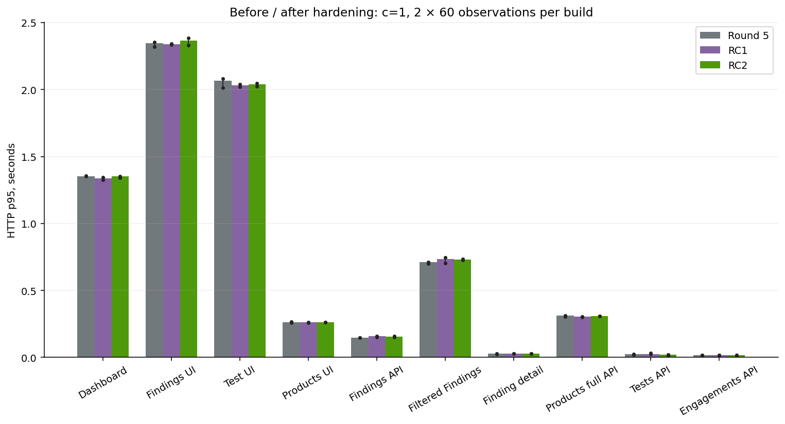

# ASPM 1.0.1 RC2 — контролируемая performance-проверка

Измерения выполнены заново 12 ноября 2026 на одном Mac M5/16 GiB, Docker VM 10 CPU/7.82 GiB, PostgreSQL 18.6, uWSGI 4 processes × 4 threads. Лимиты контейнеров, версии Python/Django/DRF и всех dependencies одинаковы; см. [environment](rc2/raw/environment.json), [dependencies](rc2/raw/dependencies.json), [images](rc2/build.json). DEBUG=false. Конфигурация сервера не настраивалась ради результата.

## Методика

Один protected seed `dd_round4_seed`: **1 000 168 findings**. Ни миграций, ни worker/beat над seed; подготовка auth добавляет только session rows, не меняя findings/products/memberships. Основная source читается только для fingerprint. 25 существующих identities (1 admin, 24 scoped), concurrency — число одновременных HTTP requests, не число независимых виртуальных пользователей. Think time=0; акторы распределены тем же генератором и seeds35101/35102/35103. Это saturation test, не моделирование 25 людей.

45 mixed runs: c1/5/10/15/25 × 3 builds × 3 repetitions, 300 measured +25 warmup/run. Порядок ABC/BCA/CAB. 60 endpoint runs: 10 routes ×3 builds ×2 repeats, 60 measured +5 warmup, c1. Всего **17,100 measured requests**; все сохранены в [raw](rc2/raw), [JSON](rc2/benchmark_results.json), [CSV](rc2/benchmark_results.csv). Warmup не входит в percentiles/RPS. Неполный подготовительный прогон с manual stop сохранён отдельно в [excluded](rc2/excluded/preflight-paused/reason.json); он не является performance-серией. Ранее утраченные `/private/tmp` результаты не подмешаны, см. [recovery](rc2/RECOVERY.md).

Workload не изменён: Findings30%, Product/severity/active filter15%, detail10%, **full Products10%**, Tests10%, Engagements5%, Dashboard10%, Products UI5%, Endpoints5%; page limit100. `findings=count`, `none`, FAST проверены отдельно, не подменяют полный ответ.

## Новая сопоставимая серия

| Показатель, c25 | Round 5 | RC1 | RC2 |
|---|---:|---:|---:|
| Mixed p50, s | 0.751 | 0.726 | 0.744 |
| Mixed p90, s | 1.788 | 1.695 | 1.764 |
| Mixed p95, s | 5.480 | 5.505 | 5.485 |
| Mixed p99, s | 10.455 | 10.285 | 10.699 |
| Mixed RPS | 16.845 | 17.414 | 17.161 |
| PostgreSQL CPU, % (100%=ядро) | 533.008 | 549.302 | 527.574 |
| uWSGI CPU, % | 115.285 | 103.268 | 102.235 |
| App container peak, MiB | 980.700 | 943.000 | 963.200 |
| Один worker peak RSS, MiB | 313.410 | 321.648 | 345.340 |
| Среднее SQL execute/request, ms | 741.010 | 721.196 | 728.958 |
| HTTP errors | 0 | 0 | 0 |
| Наблюдения / повторы | 900 / 3 | 900 / 3 | 900 / 3 |

| Вариант | p95 повторов, s | RPS повторов |
|---|---|---|
| Round 5 | 5.396, 5.480, 6.203 | 17.645, 17.200, 15.801 |
| RC1 | 5.521, 5.131, 5.945 | 17.658, 19.328, 15.646 |
| RC2 | 5.466, 5.208, 6.020 | 17.194, 17.825, 16.516 |

RC2 относительно Round 5: p95 +0.08%, RPS +1.88%. Это описательное сравнение трёх повторов, а не доказательство статистической значимости. Оба отклонения укладываются в ориентир ±10%; доказанной существенной регрессии в этой серии не установлено. Ускорение RC2 не заявляется.

Общий p95 вычислен из объединённых observations, не как среднее p95. RPS=Σrequests/Σelapsed. p99 только при n≥300; per-case mixed p95 только при n≥20. Разброс повторов виден в таблице, JSON и графиках; линии не сглажены. Для SQL: client execute wall time включает ожидание БД и передачи, не является PostgreSQL CPU time. `pg_stat_statements` недоступен; global settings не менялись. Buffers/temp counters и connections записаны монитором по реальному DB scope; это sampled deltas, не полные per-query server totals. RSS одного worker и сумма RSS не равны физической памяти из-за shared pages. CPU100%=одно логическое ядро.

## Отдельные маршруты

| Endpoint (c1, n=120/build, 2 повтора) | R5 p95, s | RC1 p95, s | RC2 p95, s | SQL R5/RC1/RC2 | Bytes RC1/RC2 |
|---|---:|---:|---:|---|---|
| dashboard | 1.351 | 1.338 | 1.351 | 15.0 / 15.0 / 15.0 | 49177.6 / 49177.6 |
| engagements | 0.016 | 0.017 | 0.017 | 9.0 / 9.0 / 9.0 | 2807.9 / 2807.9 |
| filtered_product | 0.712 | 0.734 | 0.730 | 25.0 / 25.0 / 25.0 | 287833.7 / 287833.7 |
| finding_detail | 0.027 | 0.028 | 0.029 | 24.0 / 24.0 / 24.0 | 2584.7 / 2584.7 |
| findings | 0.149 | 0.158 | 0.156 | 25.0 / 25.0 / 25.0 | 292582.0 / 292582.0 |
| products | 0.311 | 0.305 | 0.310 | 10.0 / 10.0 / 10.0 | 1604570.9 / 1604570.9 |
| tests | 0.026 | 0.026 | 0.021 | 9.0 / 9.0 / 9.0 | 8117.4 / 8117.4 |
| web_findings | 2.347 | 2.338 | 2.364 | 60.0 / 60.0 / 60.0 | 1586647.3 / 1586919.3 |
| web_products | 0.264 | 0.262 | 0.264 | 25.0 / 25.0 / 25.0 | 89823.1 / 90095.1 |
| web_test | 2.067 | 2.031 | 2.041 | 76.0 / 76.0 / 76.0 | 1560187.9 / 1560459.8 |

Полные p50/p90/p95, RPS, SQL count/time, response bytes, worker RSS, connections, buffer/temp deltas и repeat observations — в JSON. Для коротких HTTP-сценариев resource sampling может отсутствовать; такие значения остаются null. SQL plans: [R5](rc2/plans-round5.json), [RC1](rc2/plans-rc1.json), [RC2](rc2/plans-rc2.json), безопасные SELECT EXPLAIN ANALYZE BUFFERS без credentials/bindings.

## Графики

Дополнительно: SQL count и worker RSS в `rc2/charts`. Генератор `rc2/scripts/plot.py` читает JSON. Browser navigation timings записаны отдельно: [16 cold/warm navigations](rc2/raw/browser-performance.json), descriptive samples без p95-заявления; они включают CSS/JS и не смешаны с server-side HTTP latency.

Исторические 3.077s/20.57RPS (R5) и 5.01s/19.81RPS (RC1) относятся к другим сериям. Они не используются для вывода о регрессии и не входят в приведённую таблицу. External PostgreSQL и app node16vCPU/32GiB не испытывались.

Проверены historical environment snapshots: те же10 Docker CPU/7.82GiB, Python3.14.8/Django5.2.17/DRF3.18.3, DEBUG=false, CONN_MAX_AGE=0 и отсутствие per-container limits. В старых snapshots swap составлял1982.25/2174.75MiB, в новой mixed-серии0MiB. Такие snapshots могут описывать уже возвращённый demo после writes; они не доказывают DB scope конкретного старого load run. Причину старой разницы p95 по этим данным изолировать нельзя. Новая серия фиксирует DB scope/versions/settings/schedule непосредственно. [Сопоставление окружений](rc2/raw/historical-environment-comparison.json), [фактический финальный runtime](rc2/raw/actual-runtime.json).
